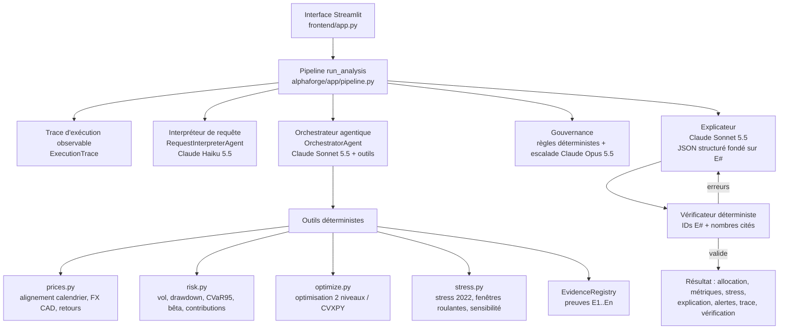

# AlphaForge AI

Prototype de **copilote de simulation d’investissement explicable** (Datathon PolyFinances 2026) : il éclaire des décisions d’investissement à partir de données publiques historiques, adaptées à un profil investisseur. **Simulation éducative uniquement — aucun conseil personnalisé, aucune exécution de transaction.**

## Capture de démonstration (emplacement)

>   
> *Emplacement : ajouter une capture de l’interface Streamlit (sélection de persona, trace d’exécution, allocation, stress 2022, explication avec preuves [E#]).*

## Architecture

Le cœur du système est déterministe : les chiffres proviennent d’outils Python et sont enregistrés comme preuves (`E1…En`) dans un registre (`alphaforge/app/evidence.py`). Les modèles Amazon Bedrock (via API Converse, `alphaforge/app/bedrock.py`) sont utilisés pour l’interprétation de requêtes, l’orchestration agentique avec outils, l’escalade de gouvernance et la rédaction d’explications structurées, puis un vérificateur déterministe (`alphaforge/app/verifier.py`) contrôle la fidélité numérique avant restitution.



**Notes factuelles :**
- Le point d’entrée utilisateur implémenté est `frontend/app.py` (Streamlit), qui appelle `alphaforge.app.pipeline.run_analysis`.
- Les agents sont dans `alphaforge/app/agents/` (`interpreter.py`, `orchestrator.py`, `governance.py`, `explainer.py`) et utilisent `BedrockConverseClient` (profil AWS `datathon` par défaut, région `us-east-1`, modèles configurés dans le code : Sonnet/Opus/Haiku 5.5 via IDs `global.anthropic.claude-*`).
- Les API FastAPI/SSE et la persistance DynamoDB/S3 décrites dans les documents de planification ne sont pas implémentées dans ce dépôt tel quel ; le pipeline retourne un dictionnaire de résultats et une trace sérialisable. Ces éléments sont **prévus** si une couche service devait être ajoutée.

## Inventaire des sources de données

Les fichiers du jeu de départ sont fournis sous `Datathon2026/alphaforge_starter/`. Métadonnées issues de `Datathon2026/alphaforge_starter/sources_metadata.csv` :

| Fichier | Contenu | Source | URL | Période / couverture | Fréquence | Traitement (métadonnées) | Limites | Conditions d’utilisation |
|---|---|---|---|---|---|---|---|---|
| `assets_universe.csv` | 31 actifs : 10 actions canadiennes ; 10 actions américaines ; 9 FNB (actions, obligations, or, filtré ESG) ; Bitcoin et Ether | Compilé par les organisateurs ; étiquettes sectorielles selon noms de secteurs GICS | n/a | n/a | statique | Sélection manuelle | Étiquettes sectorielles simplifiées/assignées par les organisateurs ; le « secteur » d’un FNB décrit l’exposition, pas une classification officielle | Libre d’utilisation dans le cadre du datathon |
| `prices_daily.csv` | OHLC quotidien, clôture, clôture ajustée, volume | Yahoo Finance via la bibliothèque open source `yfinance` | https://finance.yahoo.com | 2021-11-12 à 2026-11-12 (extrait 2026-11-13) | quotidien (jours de bourse par marché ; crypto 7 j/7) | Aucun remplissage anticipé ; aucun alignement calendaire ; lignes uniquement les jours où Yahoo rapporte un prix ; prix dans la devise de cotation | `adj_close` est rétro-ajusté pour fractionnements/dividendes (valeurs passées peuvent changer lors d’un nouveau téléchargement) ; lignes crypto = jours civils UTC ; données Yahoo non certifiées par une bourse | Conditions Yahoo : https://legal.yahoo.com/us/en/yahoo/terms/otos/index.html (consulté 2026-11-13) |
| `corporate_actions.csv` | Dividendes et fractionnements par date ex-dividende | Yahoo Finance via `yfinance` | https://finance.yahoo.com | 2021-11-12 à 2026-11-12 (extrait 2026-11-13) | événementiel | Extrait du même téléchargement que les prix | Montants de dividendes par action en devise de cotation ; potentiellement incomplet pour certains FNB | Identiques à `prices_daily.csv` |
| `fx_usdcad_daily.csv` | Taux de change quotidien USD/CAD et inverse | Banque du Canada, API Valet série `FXUSDCAD` | https://www.bankofcanada.ca/valet/observations/FXUSDCAD/json | 2021-11-12 à 2026-11-12 (extrait 2026-11-13) | jours ouvrables (jours ouvrables canadiens) | `cadusd = 1/usdcad` arrondi à 6 décimales | Taux quotidien publié vers 16 h 30 HE ; aucun taux les jours fériés canadiens | Conditions Banque du Canada : https://www.bankofcanada.ca/terms/ |
| `macro_rates.csv` | Taux directeur BdC ; rendements obligations gouv. Canada 2 ans et 10 ans ; IPC Canada a/a | Banque du Canada, API Valet (`V39079`, `BD.CDN.2YR.DQ.YLD`, `BD.CDN.10YR.DQ.YLD`, `STATIC_TOTALCPICHANGE`) | https://www.bankofcanada.ca/valet/docs | 2021-11-12 à 2026-11-12 (extrait 2026-11-13) | quotidien / mensuel | Format long ; une ligne par (`date`, `series_id`) | IPC mensuel daté au mois de référence et publié plusieurs semaines plus tard ; ne pas utiliser avant sa date de publication | Conditions Banque du Canada : https://www.bankofcanada.ca/terms/ |
| `macro_rates.csv` | Taux des fonds fédéraux US ; rendements bons du Trésor US 2 ans et 10 ans ; IPC US ; taux de chômage US | FRED (Federal Reserve Bank of St. Louis) : `DFF`, `DGS2`, `DGS10`, `CPIAUCSL`, `UNRATE` | https://fred.stlouisfed.org | 2021-11-12 à 2026-11-12 (extrait 2026-11-13) | quotidien / mensuel | Format long ; valeurs manquantes supprimées | Séries mensuelles datées au mois de référence et publiées des semaines plus tard ; valeurs = dernière révision (pas « première publication ») | Sources d’origine : agences gouvernementales américaines (Federal Reserve Board, BLS) ; voir conditions FRED : https://fred.stlouisfed.org/legal/ |

## Traitements de données (implémentés dans le code)

- **Conversion en CAD et alignement as-of du change** (`alphaforge/app/tools/prices.py`) : construction d’un calendrier unifié (union des jours où des actifs TSX ou marchés US ont négocié), réalignement des séries sur ce calendrier, remplissage avant limité (`ffill`, limite 3 jours) pour combler certains congés de marché ; réindexation du taux USD/CAD Banque du Canada sur le calendrier avec remplissage avant (et remplissage arrière si nécessaire au début) — **sans anticipation** — puis conversion des prix des actifs libellés en USD vers le CAD (`P_CAD = P_USD × FX_USDCAD`). Les titres canadiens (`.TO`, devise CAD) restent en CAD.
- **Rendements** (`prices.py`) : calcul de rendements logarithmiques quotidiens sur les prix ajustés convertis en CAD.
- **Crypto 24/7** : les prix crypto sont pivotés puis réindexés sur le calendrier boursier unifié (échantillonnage aux jours de négociation du calendrier retenu).
- **Clôture ajustée et opérations sur titres** (`prices.py`, rapport qualité) : utilisation de `adj_close` pour les rendements ; le rapport documente de ne pas réappliquer les fractionnements de `corporate_actions.csv` aux prix déjà ajustés.
- **Anomalie CNQ.TO (2022-08-22)** (`prices.py`) : le rapport qualité signale une entrée « split » de facteur 1,021 le même jour qu’un dividende de 0,75 CAD (distribution spéciale probable, non un fractionnement 1,021:1) et recommande de vérifier avant toute interprétation fine autour de cette date.
- **Décalage de publication macro (anti look-ahead)** (`prices.py`) : documentation explicite que les séries mensuelles (ex. IPC Canada/US, chômage) sont datées au mois de référence mais publiées des semaines plus tard ; recommandation de décalage (≥ 30 jours) pour tout conditionnement dynamique. Les séries macro ne sont pas intégrées comme signaux dynamiques dans le pipeline quantitatif actuel — cette contrainte est **documentée**.
- **Biais du survivant** (`prices.py`) : l’univers de 31 actifs a été constitué rétrospectivement (novembre 2026) ; les performances historiques simulées sont illustratives et non prédictives.

> D’autres traitements évoqués en planification (ex. intégration de fondamentaux, nouvelles datées, chevauchement détaillé des FNB au-delà des expositions déclarées) ne sont pas implémentés dans le code actuel : **prévus / non implémentés**.

## Hypothèses de persona (équipe)

Les personas de référence et leurs contraintes chiffrées sont définis dans `alphaforge/app/personas.py` et explicitement marqués comme **hypothèses d’équipe / paramétrage opérationnel** (les paramètres qualitatifs proviennent du cas officiel). Résumé :

| Persona (cas officiel) | Profil de risque / horizon (cas) | Paramétrage implémenté (hypothèses d’équipe, voir `personas.py`) | Particularités implémentées |
|---|---|---|---|
| **Amira** (26 ans, ingénieure logicielle) | Élevé, 15+ ans | Bandes/poches stratégiques et contraintes intra-poche (actions ~80 %, crypto ~10 %, obligations ~5 %, or ~5 %), plancher techno (exposition IA/tech), crypto plafonnée (ex. 10 % total dans le paramétrage), plafond par actif individuel (ex. 10 % total) | Univers actions incluant titres techno/IA ; crypto (BTC, ETH) dans la poche dédiée |
| **Mateo** (41 ans, gestionnaire des opérations) | Modéré, 8–12 ans | Poches stratégiques (actions/obligations/or), crypto exclue, exclusions provisoires ESG de certains titres énergie/fossiles (`CNQ.TO`, `ENB.TO`, `XOM`) et utilisation d’`ESGV` comme véhicule ESG principal — **hypothèse provisoire** (« à remplacer par source ESG », réf. enjeu #4 dans le code) | Filtrage ESG opérationnel limité aux règles/exclusions codées et aux actifs disponibles |
| **Robert** (59 ans, professionnel de la santé) | Faible à modéré, 3–5 ans | Forte poche obligataire (socle de préservation), actions défensives, crypto interdite par règles, actif spéculatif médiatisé (ex. TSLA) exclu en base et traité comme cas d’incohérence avec alternative plafonnée (satellite) selon la logique de gouvernance/évaluation | Test « actif médiatisé plus risqué que le profil » généralisable par la logique de gouvernance |

> Les valeurs numériques exactes (plafonds, planchers, bandes de volatilité cibles) sont celles codées dans `personas.py` et doivent être lues comme des **choix d’équipe** documentés, pas comme des constantes imposées par le cas.

## Explicabilité et garde-fous

- **Preuves [E#]** : chaque exécution d’outil enregistrée via `EvidenceRegistry.register(...)` produit une preuve avec identifiant, outil, arguments, résultat, source, date/devise et métriques de synthèse.
- **Trace observable** (`alphaforge/app/trace.py`) : événements structurés (`step_start`, `tool_call`, `evidence_added`, `governance_alert`, `verification_result`, `done`) destinés à l’affichage/traçabilité ; **pas d’exposition de chaîne de pensée interne**.
- **Explication structurée** (`alphaforge/app/schemas.py`, agent explicateur) : format JSON aligné sur les rubriques BNCD (résumé, données utilisées, justification, limites, ce qui changerait la réponse, alertes de gouvernance) avec références `evidence_ids`.
- **Vérificateur déterministe** (`alphaforge/app/verifier.py`) : vérifie l’existence des `E#` cités et la présence des nombres des affirmations dans les preuves citées (tolérances/équivalences gérées). En cas d’échec, l’explicateur tente une régénération corrective ; une sanitation déterministe peut être appliquée pour garantir la conformité.
- **Gouvernance** (`alphaforge/app/governance.py`, `alphaforge/app/agents/governance.py`) : règles codées (ex. crypto prohibée pour Robert, traitement des demandes TSLA, plancher obligataire, contrôles de concentration, exclusions/alertes ESG provisoires pour Mateo, avis de simulation obligatoire) avec escalade possible vers Claude Opus pour cas ambigus/texte libre.
- **Limites responsables** : simulation éducative uniquement ; distinction faits/hypothèses/scénarios dans la conception de l’explication ; pas d’exécution de transactions.

## Installation, exécution et tests

### Prérequis
- Python (environnement du projet fourni dans ce contexte : `/home/wilson-lab/Datathon-Poly/.venv`)  
- Dépendances analytiques/UI observées dans le code (ex. `pandas`, `numpy`, `cvxpy`, `streamlit`, `plotly`, `boto3`, `pydantic`, `pytest`) — installer les paquets manquants dans l’environnement cible si nécessaire.

Exemple d’installation de paquets avec l’outil indiqué :
```bash
/home/wilson-lab/.local/bin/uv pip install -p /home/wilson-lab/Datathon-Poly/.venv <pkg>
```

### Lancer l’interface Streamlit
```bash
cd /home/wilson-lab/Datathon-Poly/wt-docs
AWS_PROFILE=datathon AWS_REGION=us-east-1 /home/wilson-lab/Datathon-Poly/.venv/bin/streamlit run frontend/app.py
```
> L’analyse complète via l’interface et le pipeline peut invoquer Amazon Bedrock (Converse) selon la configuration AWS et les modèles disponibles.

### Exécuter le script de simulation déterministe des personas (sans couche UI)
```bash
cd /home/wilson-lab/Datathon-Poly/wt-docs
/home/wilson-lab/Datathon-Poly/.venv/bin/python alphaforge/scripts/run_personas.py
```

### Tests
```bash
cd /home/wilson-lab/Datathon-Poly/wt-docs
/home/wilson-lab/Datathon-Poly/.venv/bin/python -m pytest
```
- Les tests marqués `bedrock` (ex. `alphaforge/tests/test_bedrock_live.py`) nécessitent des identifiants AWS valides et l’accès aux modèles Bedrock configurés.

## Structure du dépôt (principaux éléments)

```text
.
├── README.md
├── docs/
│   ├── CASE_NOTES.md
│   ├── PLAN.md
│   ├── PHASE1_REPORT.md
│   ├── ONE_PAGER.md                # (ce livrable)
│   └── PITCH.md                    # (ce livrable)
├── frontend/
│   └── app.py                      # Interface Streamlit
├── alphaforge/
│   ├── app/
│   │   ├── pipeline.py             # Orchestration run_analysis
│   │   ├── evidence.py             # Registre de preuves E#
│   │   ├── verifier.py             # Vérification déterministe
│   │   ├── governance.py           # Règles de gouvernance
│   │   ├── personas.py             # Personas et contraintes (hypothèses d’équipe)
│   │   ├── bedrock.py              # Client Bedrock Converse
│   │   ├── schemas.py, trace.py
│   │   ├── agents/                 # interpreter, orchestrator, governance, explainer
│   │   └── tools/                  # prices, risk, optimize, stress
│   ├── scripts/
│   │   └── run_personas.py         # Exécution déterministe des scénarios personas
│   └── tests/                      # tests outils, vérificateur, personas, bedrock (mock/live)
└── Datathon2026/
    └── alphaforge_starter/         # Données de départ, métadonnées, script de génération
```

## Limites

- **Biais du survivant** : univers sélectionné rétrospectivement.
- **Couverture ESG/fondamentaux/nouvelles** : pas de cotes ESG tierces, pas de RAG documentaire sur dépôts réglementaires ni de flux de nouvelles datées intégrés dans le pipeline actuel (exclusions/étiquettes ESG partielles et provisoires selon le code).
- **Stress tests** : épisode historique 2022 implémenté comme scénario principal de stress dans les outils/pipeline présentés ; autres régimes (ex. 2008, 2020) non implémentés comme scénarios dédiés dans ce code.
- **Pas de prédiction de rendements** : optimisation fondée sur la structure de risque/covariance historique et contraintes, sans prévision de rendement futur.
- **Dépendance AWS/Bedrock** pour les fonctions agentiques LLM (interprétation, génération d’explication, escalade gouvernance) ; le script `run_personas.py` illustre un pipeline déterministe distinct.
- **Absence de couche API serveur (FastAPI/SSE) et de stockage cloud (S3/DynamoDB)** dans ce dépôt : éléments mentionnés en planification, **non implémentés** ici.

## Équipe et crédits (à compléter)

- **Équipe :** _[Noms des membres à renseigner]_
- **Défi :** Datathon PolyFinances 2026 — AlphaForge AI
- **Données de départ :** organisateurs du datathon (voir `Datathon2026/alphaforge_starter/`)
- **Sources externes des données :** Yahoo Finance (`yfinance`), Banque du Canada (API Valet), FRED — voir tableau des sources et conditions ci-dessus.

> Rappel : ce projet est un prototype de simulation éducative. Il ne constitue ni un conseil en placement, ni une recommandation personnalisée, ni une invitation à transiger. 
