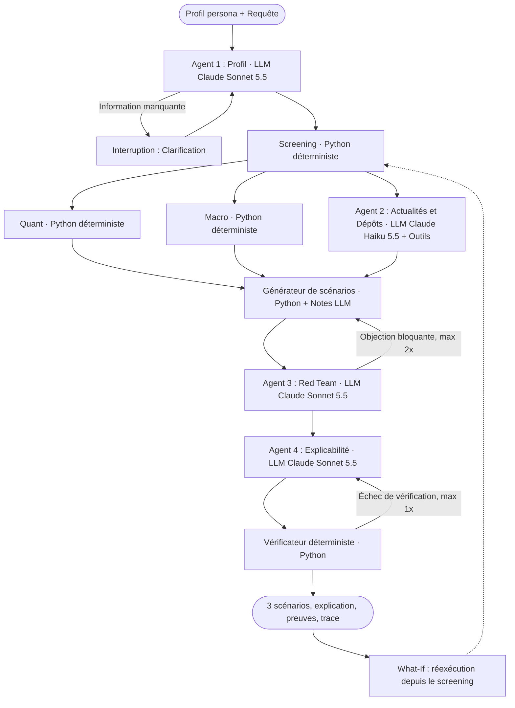

# AlphaForge AI

> **Moteur de deuxième avis pour les décisions d'investissement — Simulation éducative uniquement.**  
> Datathon PolyFinances 2026 (Banque Nationale Courtage direct & AWS).  
> **Aucun conseil personnalisé. Aucune exécution d'ordres. Aucune prévision de rendement futur.**

---

## 1. Présentation du Projet

AlphaForge AI est un moteur d'analyse et d'explicabilité financière destiné à fournir un **deuxième avis objectif et vérifiable** sur des propositions d'allocation d'actifs ou sur l'évaluation d'un titre individuel.

Conçu pour répondre aux exigences de transparence formulées par la **Banque Nationale Courtage direct (BNCD)** et exploitant les capacités d'orchestration agentique d'**Amazon Web Services (AWS)**, le système prend en charge deux types de requêtes :
- **Construction (`build`)** : *« J'ai 100 000 $ CAD, un horizon de 15 ans et plus. J'aime la techno et la crypto mais je veux rester diversifiée. »*
- **Évaluation (`judge`)** : *« Je veux mettre 25 % de mon portefeuille dans TSLA. »*

À partir du profil de l'investisseur (Amira, Mateo ou Robert), AlphaForge AI filtre un univers de 31 actifs par des contraintes réglementaires et éthiques strictes, analyse les risques historiques en CAD, génère **trois scénarios comparables** (`as_requested`, `capped`, `profile_baseline`), et explique les écarts observés à travers les quatre questions fondamentales de l'atelier BNCD :
1. **Quelles données ont été utilisées ?**
2. **Pourquoi ce choix d'allocation ?**
3. **Quelles sont les limites des données et des modèles ?**
4. **Qu'est-ce qui changerait la réponse ?**

Chaque chiffre avancé dans l'explication est audité par un **vérificateur déterministe** qui garantit la stricte concordance numérique avec les données sources avant toute restitution.

---

## 2. Accès à l'Application Déployée (Live AWS)

L'application est entièrement déployée et accessible publiquement sur AWS :

- **Application Web & API REST** : [http://18.206.125.42/](http://18.206.125.42/)
- **Vérification d'état (*Health check*)** : [http://18.206.125.42/health](http://18.206.125.42/health) (`{"status":"ok"}`)
- **Liste des Personas** : [http://18.206.125.42/personas](http://18.206.125.42/personas)
- **Documentation technique détaillée** : [docs/TECHNICAL.md](docs/TECHNICAL.md)

---

## 3. Démarrage Rapide (*Quick Start*)

### 3.1 Prérequis
- Python 3.12+ avec le gestionnaire de paquets [`uv`](https://docs.astral.sh/uv/)
- Node.js 20+ et npm
- Compte AWS (pour l'inférence Bedrock en mode direct ; un mode de relecture hors ligne est disponible par défaut pour les tests)

### 3.2 Installation et Lancement

```bash
# 1. Cloner le dépôt et synchroniser l'environnement virtuel Python
uv sync

# 2. Exécuter la suite complète de tests et le linter
uv run pytest -q
uv run ruff check .

# 3. Lancer une exécution en ligne de commande (ex. persona Robert)
uv run python -m alphaforge.graph robert

# 4. Démarrer le serveur d'API FastAPI (SSE)
uv run uvicorn alphaforge.api.server:app --reload --port 8000
```

Dans un second terminal, lancer l'interface React :

```bash
cd frontend
npm install
npm run dev
```

L'interface web locale est alors accessible sur `http://localhost:5173/` et communique avec l'API sur le port 8000.

---

## 4. Architecture Multi-Agents (LangGraph)

Le moteur est modélisé sous la forme d'un graphe d'état typé avec **LangGraph** ([alphaforge/graph.py](alphaforge/graph.py)), garantissant l'auditabilité et le streaming temps réel de chaque étape vers l'interface utilisateur.



---

## 5. Les Trois Personas et Scénarios de Test

L'application propose trois profils types représentatifs issus des cas d'usage BNCD :

| Persona | Caractéristiques & Hypothèses | Requête type recommandée | Comportement attendu du système |
|---|---|---|---|
| **Amira** (26 ans) | Horizon 15+ ans, tolérance élevée, capacité élevée. Préfère les technos et cryptos, mais recherche la diversification. | *« J'ai 100 000 $ CAD, un horizon de 15 ans et plus. J'aime la techno et la crypto mais je veux rester diversifiée. »* | Les 31 actifs sont admissibles. L'exposition crypto est plafonnée à 10 %. Le chevauchement QQQ / SPY est mis en évidence. Le scénario `capped` réduit la perte maximale historique de -47,5 % à -38,4 %. |
| **Mateo** (41 ans) | Horizon 10 ans, tolérance modérée, capacité modérée. Portefeuille équilibré, critères ESG stricts, évitement des controverses. | *« Je veux un portefeuille équilibré et responsable sur environ 10 ans, sans entreprises controversées. »* | Exclusion stricte des cryptoactifs (`no_crypto`) et du secteur énergétique fossile (ENB.TO, CNQ.TO, XOM). Validation du filtre ESG par les détentions de Vanguard ESGV. Scénario plafonné modéré (`capped`, volatilité de 12,2 %) et scénario de référence équilibré (`profile_baseline`, volatilité de 5,5 %). |
| **Robert** (59 ans) | Horizon 4 ans, tolérance faible à modérée, capacité faible. Objectif de préservation du capital, attiré par un titre volatil. | *« Je veux mettre 25 % de mon portefeuille dans TSLA. »* | L'Agent 1 relève le conflit : 25 % dans TSLA excède le plafond de tolérance de 5 % pour un horizon court de 4 ans. Comparaison du choc de 2022 : -21,2 % pour la demande brute contre -4,9 % pour le scénario plafonné. Langage de cohérence sans aucun refus brutal. |

### Ce qu'il faut tester (Démonstration interactive)
1. **Évaluer une idée avec Robert** : observer comment le système compare objectivement le risque de perte extrême entre l'idée brute (25 % TSLA, -23,2 % de drawdown) et l'alternative plafonnée (5 % TSLA, -6,1 % de drawdown).
2. **Construire une allocation avec Amira** : constater le plafonnement de la poche crypto (5 % BTC, 5 % ETH) et la détection du chevauchement indiciel technologique.
3. **Tester une variation d'hypothèse (*What-If*)** : modifier l'horizon de Robert de 4 ans à 15 ans ou exclure un titre (ex. TSLA) pour visualiser en direct l'impact différentiel sur les trois scénarios.

---

## 6. Services AWS et Justification de l'Architecture

L'infrastructure cloud d'AlphaForge AI est hébergée sur **Amazon Web Services** dans la région `us-east-1` ([infra/README.md](infra/README.md)) :

| Service AWS | Rôle dans l'application | Justification technique |
|---|---|---|
| **Amazon Bedrock** | Inférence des modèles de fondation | Utilisation de Claude Sonnet 5.5 (`global.anthropic.claude-sonnet-5-5`) pour les agents d'extraction de profil (Agent 1) et de rédaction d'explication et de synthèse (Agent 4), et de Claude Haiku 5.5 (`global.anthropic.claude-haiku-5-5`) pour la classification rapide d'actualités (Agent 2). L'Agent 3 (Red Team) utilise aussi Claude Sonnet 5.5 pour la relecture critique des scénarios. |
| **Amazon S3** (`alphaforge-data-908027403910`) | Stockage objet centralisé | Hébergement versionné des jeux de données d'origine (`starter/`), des caches JSON de détentions FNB et dépôts SEC (`cache/`), et délestage automatique des états complets de graphe (`runs/<run_id>.json`) dépassant le seuil de 400 Ko de DynamoDB. |
| **Amazon DynamoDB** (`alphaforge-traces`) | Journal d'audit et persistance | Table NoSQL à la demande (*pay-per-request*) enregistrant les métadonnées de chaque exécution, les traces d'étapes horodatées et les statuts de validation pour une auditabilité totale. |
| **Amazon EC2 & ECR** | Hébergement du conteneur applicatif | Instance `t3.medium` (`AlphaForge-Server`, ID `i-0ec3c5dff3ac51dc4`) exécutant l'image Docker multi-stage (FastAPI servant l'API REST, les flux SSE et les fichiers statiques de l'application React). Les images sont stockées sur Amazon ECR. |
| **Amazon CloudWatch** (`/alphaforge/app`) | Surveillance et observabilité | Collecte en continu des journaux applicatifs du conteneur via le pilote de journalisation Docker `awslogs`. |
| **AWS Systems Manager (SSM)** | Déploiement continu sans perturbation | Automatisation des mises à jour applicatives sans interruption de service via `redeploy.sh`. |

> [!NOTE]
> **Choix d'EC2 plutôt qu'App Runner** :  
> Le plan d'architecture initial prévoyait AWS App Runner (PRD §2). En raison de restrictions de privilèges propres au compte de bac à sable (*sandbox*) du workshop AWS, le service App Runner a été bloqué. Conformément au plan de mitigation documenté au PRD §8, le système a basculé sur une instance Amazon EC2 `t3.medium` conteneurisée.

---

## 7. Sources de Données et Traitement

Toutes les données utilisées sont publiques, horodatées et documentées :

| Source / Fichier | Période / Date d'observation | Contenu & Couverture | Traitement méthodologique appliqué |
|---|---|---|---|
| **`assets_universe.csv`** | Novembre 2026 | 31 actifs : 10 actions canadiennes (TSX), 10 actions américaines (NYSE/NASDAQ), 9 FNB, 2 cryptoactifs (BTC, ETH). | Catégorisation sectorielle, classe d'actif et devise d'origine. |
| **`prices_daily.csv`** | 2021-11-12 au 2026-11-12 (~40 000 lignes) | Cours quotidiens (Yahoo Finance via `yfinance`) sur 5 ans pour intégrer le recul obligataire et boursier de 2022. | Calcul des rentabilités exclusivement sur `adj_close` (cours ajusté des dividendes et fractionnements). Retrait des fins de semaine pour les cryptos. |
| **`fx_usdcad_daily.csv`** | 2021-11-12 au 2026-11-12 (~1 250 lignes) | Taux de change officiel USD/CAD de la Banque du Canada (API Valet). | Conversion de tous les actifs américains et cryptos en CAD. Report de cours vers l'avant (*forward-fill*) pour les jours fériés canadiens. |
| **`macro_rates.csv`** | 2021-11-12 au 2026-11-12 (~8 300 lignes) | Séries de la Banque du Canada (taux directeur V39079, rendements 2y/10y, IPC) et de FRED (fonds fédéraux DFF, rendements 2y/10y, IPC, chômage US UNRATE). | Application d'un délai de publication réaliste (*publication lag*) par série pour éviter tout biais de prévoyance. |
| **FNB SPY** (`SPY.json`) | 2026-11-12 | Composition intégrale (503 titres, couverture 99,87 %). Source : State Street. | Normalisation des pondérations, extraction des titres pour le calcul de chevauchement indiciel. |
| **FNB XIU.TO** (`XIU.TO.json`) | 2026-11-12 | Composition intégrale (60 titres TSX, couverture actions 100 %). Source : BlackRock iShares Canada. | Normalisation des symboles avec suffixe `.TO`. |
| **FNB QQQ** (`QQQ.json`) | 2026-11-13 | 25 premières positions sur 104 (71,3 % du fonds). Source : stockanalysis.com. | Liste partielle signalée comme borne inférieure lors des calculs de chevauchement. |
| **FNB ESGV** (`ESGV.json`) | 2026-09-30 | 25 premières positions sur 1 220 (55,9 % du fonds). Source : stockanalysis.com. | Utilisé pour corroborer le filtrage ESG des grandes capitalisations américaines pour Mateo. |
| **Dépôts SEC EDGAR** (`sec_edgar_*.json`) | Extraits au 2026-11-15 (données 2025–2026) | Déclarations réglementaires officielles SEC (Form 8-K, 10-Q, 10-K, proxy statements) pour TSLA, NVDA, XOM, ENB.TO et BTC-USD (ETF IBIT CIK 1980994). | Extraction des rubriques matérielles (ex. item 1.01 engagement financier, 2.02 résultats financiers) et horodatage à la date de publication. |

---

## 8. Limites Connues

Conformément aux normes d'intégrité de l'exercice :
1. **Compositions partielles de FNB** : Seules les 25 premières détentions sont répertoriées pour QQQ et ESGV ; les chevauchements calculés représentent des bornes inférieures.
2. **Dépôts réglementaires plutôt que fil de presse** : En mode cache autonome, les événements reposent sur les dépôts SEC EDGAR sans analyse de la presse économique générale.
3. **Absence du chômage canadien** : Le jeu de données macroéconomiques ne comprend pas le taux de chômage canadien.
4. **Biais du survivant** : L'univers de 31 actifs regroupe des entreprises liquides et en activité en 2026.
5. **Date fixe des FNB** : La composition des FNB est figée à l'instantané de fin 2026.

---

## 9. Équipe et Pôles de Réalisation

Projet réalisé dans le cadre du Datathon PolyFinances 2026 :

- **Orchestration générale & Intégration** : Claude (via @LyWilson)
- **Track A — Données & Calculs Quantitatifs** : @jolojo500
- **Track B — Agents LLM, Gouvernance & Vérification** : @d3mh4
- **Track C — Produit, Interface & Déploiement AWS** : @rbhunjun22

Pour le détail complet des formules mathématiques, des règles de vérification, de l'évaluation de l'Agent 2 et des résultats chiffrés sur les personas, veuillez consulter le document technique : **[docs/TECHNICAL.md](docs/TECHNICAL.md)**.
