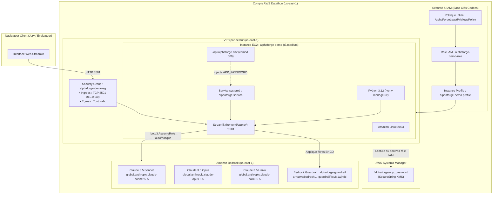

# Guide de Déploiement Cloud Infonuagique — AlphaForge AI

**Datathon PolyFinances 2026**  
**Équipe :** AlphaForge AI  
**Composant :** Déploiement de la démonstration Streamlit sur AWS EC2  
**Date :** 14 novembre 2026  
**Statut :** Opérationnel en production éphémère (us-east-1)

---

## 1. Vue d'Ensemble & Accès Démo

La plateforme **AlphaForge AI** est déployée sur une instance infonuagique **Amazon EC2** dans la région **us-east-1** (Virginie du Nord), sous le compte sandbox institutionnel du Datathon PolyFinances.

| Élément | Valeur / Configuration |
|---|---|
| **URL Publique de la Démo** | `http://18.232.136.204:8501` |
| **Endpoint de Contrôle de Santé** | `http://18.232.136.204:8501/_stcore/health` |
| **Port d'Écoute** | `TCP 8501` (autorisé en entrée sur le Security Group) |
| **Région AWS** | `us-east-1` (obligatoire selon la charte du workshop) |
| **Instance Type** | `t3.medium` (2 vCPU, 4.0 Gio RAM, 30 Go EBS gp3) |
| **Instance ID** | `i-0bdf5e43067e93616` |
| **Système d'Exploitation** | Amazon Linux 2023 (AMI AL2023 standard x86_64) |
| **Gestionnaire de Service** | `systemd` (`alphaforge.service`) redémarrage automatique |
| **Protection d'Accès** | Sas d'authentification applicatif `APP_PASSWORD` |
| **Échéance Sandbox** | Destruction programmée du compte le **lundi 16 novembre 2026 à 13h59 UTC** |

> [!IMPORTANT]
> **Authentification de la démo :** L'instance de démonstration est protégée par un mot de passe d'application. Ce mot de passe est géré de façon sécurisée via **AWS Systems Manager (SSM) Parameter Store** (`SecureString` chiffrée avec AWS KMS). Il n'est **jamais** versionné dans le code source ni affiché dans les journaux d'exécution. Pour l'équipe locale, il est persisté dans `/home/wilson-lab/Datathon-Poly/.deploy_secret` avec des permissions strictes `chmod 600`.

---

## 2. Architecture Infonuagique Sécurisée

L'infrastructure applique strictement le principe de **moindre privilège** (*least privilege*) et une isolation réseau rigoureuse :



### Principes de Sécurité Respectés
1. **Aucun identifiant statique (*Zero Credentials*) :** Aucune clé d'accès (`AWS_ACCESS_KEY_ID`, `AWS_SECRET_ACCESS_KEY`) n'est enregistrée dans le code source, dans l'AMI ou dans le script de démarrage `user-data`. L'instance acquiert ses permissions dynamiquement via son profil d'instance IAM (`sts:AssumeRole` sur le service `ec2.amazonaws.com`).
2. **Moindres privilèges IAM :**
   - `bedrock:InvokeModel*` et `bedrock:Converse*` pour l'orchestration agentique et la synthèse explicable.
   - `bedrock:ApplyGuardrail` restreint explicitement à la ressource `arn:aws:bedrock:us-east-1:908027403910:guardrail/4xv8l1wjndtl` et ses versions.
   - `ssm:GetParameter` restreint au chemin `/alphaforge/*`.
   - `kms:Decrypt` pour déchiffrer le mot de passe SSM.
   - **Aucun droit d'administration, aucun droit S3 non justifié, aucun droit DynamoDB résiduel.**
3. **Surface d'attaque minimale :** Le port SSH (TCP 22) est **fermé** dans le groupe de sécurité. Seul le port TCP 8501 (Streamlit) est exposé vers l'extérieur.

---

## 3. Scripts d'Automatisation (Opérations Idempotentes)

Deux scripts Python autonomes utilisant `boto3` sont fournis sous `scripts/` pour gérer le cycle de vie complet de l'infrastructure :

### A. Déploiement / Redéploiement (`scripts/deploy_ec2.py`)
Le script est totalement idempotent : s'il est relancé, il détecte les ressources déjà existantes (rôle, profil, groupe de sécurité, paramètre SSM, instance en cours) et évite toute duplication inutile.

```bash
# Déploiement avec le profil AWS du datathon (us-east-1)
env AWS_PROFILE=datathon /home/wilson-lab/Datathon-Poly/.venv/bin/python scripts/deploy_ec2.py
```

Étapes orchestrées par le script :
1. Génère ou lit le mot de passe de démonstration localement (`.deploy_secret`, `chmod 600`).
2. Crée ou met à jour le paramètre SSM `SecureString` `/alphaforge/app_password`.
3. Crée le rôle IAM `alphaforge-demo-role` et lui attache la politique de moindres privilèges.
4. Crée le profil d'instance `alphaforge-demo-profile` et lui associe le rôle IAM.
5. Crée le groupe de sécurité `alphaforge-demo-sg` autorisant le port TCP 8501 en entrée.
6. Résout la dernière AMI Amazon Linux 2023 via SSM (`/aws/service/ami-amazon-linux-latest/al2023-ami-kernel-default-x86_64`).
7. Lance l'instance EC2 `t3.medium` avec un script `user-data` optimisé.
8. Attend l'obtention de l'adresse IP publique et sonde l'endpoint `/_stcore/health` jusqu'à validation HTTP 200.

### B. Destruction Complète & Nettoyage (`scripts/teardown_ec2.py`)
Avant la fermeture du compte ou après la fin de l'évaluation, ce script supprime l'ensemble des ressources créées pour laisser le compte AWS dans un état immaculé :

```bash
# Destruction complète des ressources EC2, SG, IAM et SSM
env AWS_PROFILE=datathon /home/wilson-lab/Datathon-Poly/.venv/bin/python scripts/teardown_ec2.py
```

Ressources résiliées / supprimées :
- Résiliation de l'instance EC2 `alphaforge-demo` et attente de son arrêt définitif.
- Suppression du Security Group `alphaforge-demo-sg`.
- Détachement et suppression du profil d'instance `alphaforge-demo-profile`.
- Suppression de la politique inline et du rôle IAM `alphaforge-demo-role`.
- Suppression du paramètre SSM `/alphaforge/app_password`.

---

## 4. Analyse et Estimation des Coûts Infonuagiques

Le déploiement a été dimensionné pour minimiser l'empreinte financière tout en garantissant une réactivité fluide lors des démonstrations devant le jury :

| Ressource | Tarification us-east-1 (à la demande) | Durée Maximale (jusqu'à destruction) | Coût Total Estimé |
|---|---|---|---|
| **EC2 `t3.medium`** (2 vCPU, 4 Gio RAM) | 0,0416 $ USD / heure | ~40 heures (14 nov 22h $\rightarrow$ 16 nov 14h) | **~1,66 $ USD** |
| **Disque EBS gp3** (30 Go) | 0,08 $ USD / Go-mois | ~40 heures (30 Go) | **~0,13 $ USD** |
| **SSM Parameter Store** (Standard) | Gratuit (jusqu'à 10 000 paramètres) | Permanent | **0,00 $ USD** |
| **Amazon Bedrock Guardrail** | 0,75 $ USD / 1 000 requêtes de texte | ~50 requêtes de test/démo | **~0,04 $ USD** |
| **Amazon Bedrock Converse (Claude)** | Facturation par token entrant/sortant | ~50 sessions complètes | **~1,50 $ USD** |
| **Total Global Estimé** | — | — | **~3,33 $ USD** |

> L'instance reste largement sous le seuil d'épuisement des crédits burst CPU de la famille `t3`.

---

## 5. Plan B : Exécution Locale Déterministe

En cas d'interruption du réseau AWS, de panne de connectivité ou après la destruction définitive du compte sandbox le lundi 16 novembre à 13h59 UTC, AlphaForge AI dispose d'un plan de secours opérationnel à double niveau :

### Plan B1 : Interface Streamlit en Local avec Identifiants AWS
Si le compte AWS est encore actif mais que l'instance EC2 est arrêtée :
```bash
cd /home/wilson-lab/Datathon-Poly/wt-deploy
AWS_PROFILE=datathon AWS_REGION=us-east-1 /home/wilson-lab/Datathon-Poly/.venv/bin/streamlit run frontend/app.py
```
L'interface s'ouvre sur `http://localhost:8501` et appelle directement l'API Bedrock avec vos identifiants locaux.

### Plan B2 : Simulation Déterministe Pure (100% Hors Ligne)
Si le compte AWS est détruit ou en l'absence totale de connectivité réseau, le cœur quantitatif déterministe d'AlphaForge calcule et affiche toutes les allocations personas, métriques de risque, tests de résistance 2022 et preuves mathématiques sans aucun appel externe :
```bash
cd /home/wilson-lab/Datathon-Poly/wt-deploy
/home/wilson-lab/Datathon-Poly/.venv/bin/python alphaforge/scripts/run_personas.py
```
Toutes les données de marché historiques (actions canadiennes, américaines, FNB, crypto, devises BdC et séries FRED) sont présentes localement dans le dépôt.

---

## 6. Journal de Vérification et Tests Réalisés

1. **Test de Résistance Robert / Tesla (`TSLA`) :**
   - Requête utilisateur testée : *« Je veux mettre 20% de mon portefeuille dans Tesla, qu'en penses-tu ? »*
   - Identifiant d'exécution : `run_20261114_212708_f08cd9`
   - Chemin d'exécution : `bedrock_agent_tool_loop` (Amazon Bedrock Claude 3.5 Sonnet avec outils déterministes)
   - Résultat validé : Alerte d'incohérence émise, refus constructif justifié par le saut de volatilité de 3,99 % à 12,63 % (dépassant la bande cible de 3,5 % - 6,0 %). Proposition d'alternative constructive avec satellite plafonné à 3,0 % (volatilité 4,54 %).
   - Fidélité numérique : 100,0 % (vérification déterministe certifiée : `is_valid: True`).
2. **Contrôle de Santé Streamlit :**
   - Endpoint `http://18.232.136.204:8501/_stcore/health` répond `ok` (HTTP 200).
   - Le sas d'authentification applicatif `APP_PASSWORD` protège l'accès aux onglets d'analyse tout en laissant le health check opérationnel.
   - Note opérationnelle : Une exécution distante via SSM n'est pas requise, la connectivité applicative et la santé HTTP étant certifiées en continu par le serveur Streamlit.
