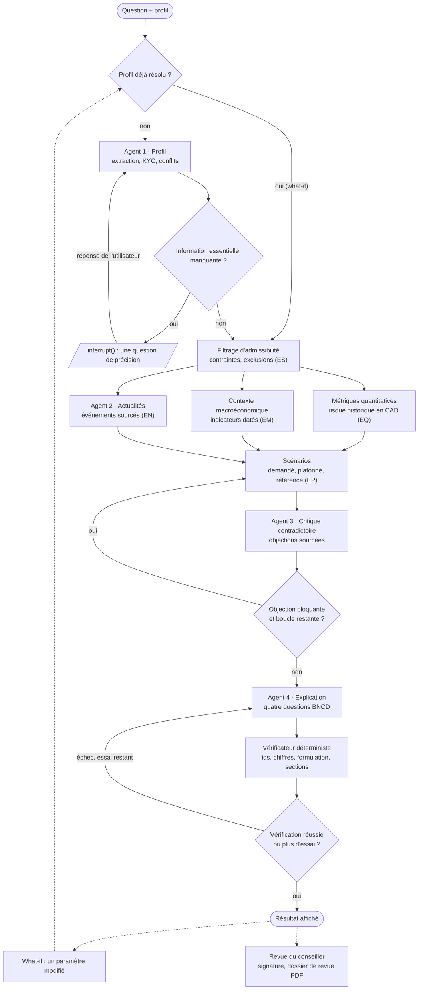
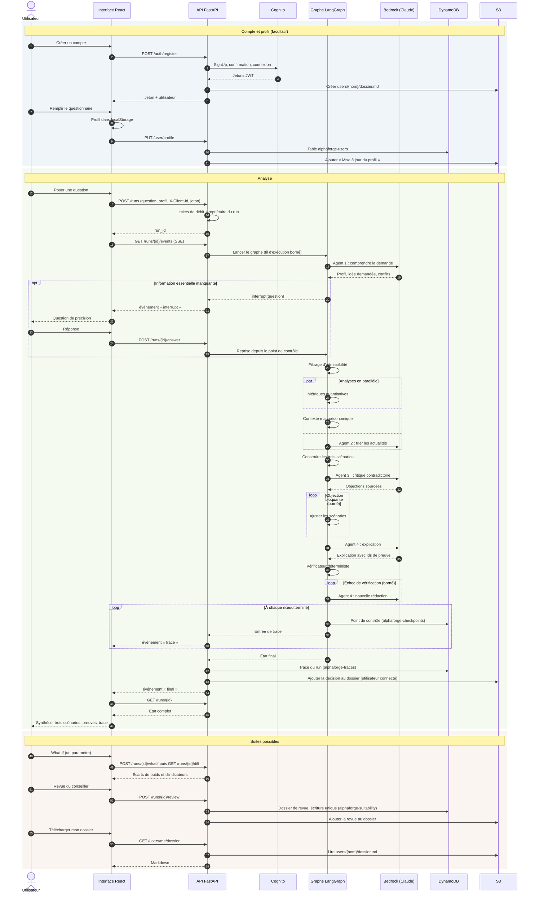
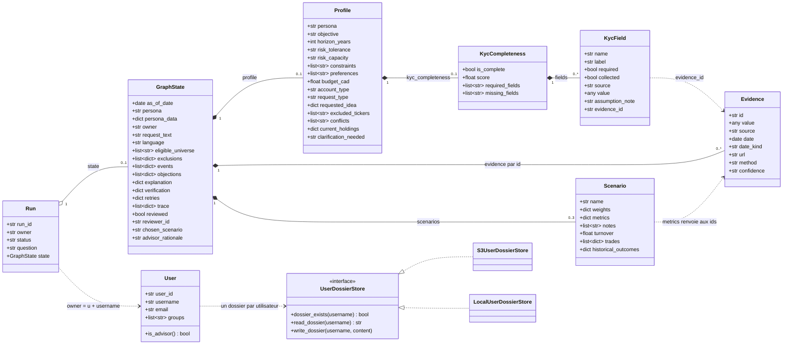

# AlphaForge AI — Diagrammes

Trois vues du système tel qu'il est dans `main` : le flux de travail des agents, la séquence complète d'une analyse, et le modèle de données (UML). Le détail des nœuds est dans [TECHNICAL.md](TECHNICAL.md), les contrats dans [PRD.md](PRD.md).

## 1. Flux de travail (graphe LangGraph)

Le graphe est défini dans [`alphaforge/graph.py`](../alphaforge/graph.py). Les trois analyses tournent en parallèle ; les deux boucles sont bornées par `MAX_RED_TEAM_LOOPS` et `MAX_EXPLAIN_RETRIES`.

## 2. Séquence complète d'une analyse

De la création du compte au dossier dans S3. Les étapes de compte sont facultatives : un utilisateur anonyme suit la même séquence sans les appels à Cognito, à la table des utilisateurs ni à S3.

## 3. Modèle de données (UML)

Les modèles Pydantic sont dans [`alphaforge/state.py`](../alphaforge/state.py). `GraphState` est le seul objet qui circule entre les nœuds ; chaque chiffre affiché renvoie à une `Evidence` par son identifiant.

### Préfixes des identifiants de preuve

| Préfixe | Produit par | Contenu |
|---|---|---|
| `ES` | Filtrage | Exclusions et règles d'admissibilité |
| `EQ` | Métriques quantitatives | Statistiques de risque par actif |
| `EM` | Contexte macroéconomique | Indicateurs datés |
| `EN` | Agent 2 | Actualités et événements |
| `EP` | Scénarios | Indicateurs de portefeuille, plafonds, frais, fiscalité |
| `EK` | Agent 1 | Champs KYC et hypothèses |

### Où vit chaque donnée

| Donnée | Emplacement |
|---|---|
| Profil du questionnaire (anonyme) | `localStorage` du navigateur |
| Profil du compte, avoirs | DynamoDB `alphaforge-users` |
| État du graphe à chaque nœud | DynamoDB `alphaforge-checkpoints` |
| Trace et résultat d'un run | DynamoDB `alphaforge-traces` |
| Dossier de revue du conseiller | DynamoDB `alphaforge-suitability` |
| Dossier de l'utilisateur (profil, décisions) | S3 `users/<nom>/dossier.md` |
| Comptes et groupes | Cognito |
