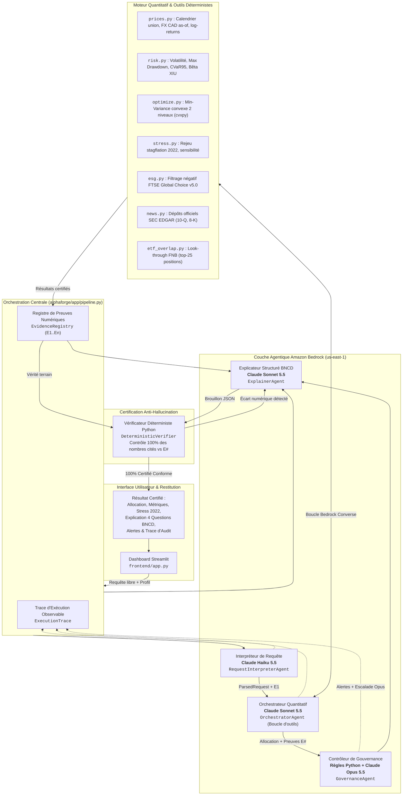

# AlphaForge AI — Documentation Technique
**Copilote de Simulation et d'Aide à la Décision d'Investissement Explicable**  
*Datathon PolyFinances × AWS × Banque Nationale (2026)*  
**Dépôt :** `jolojo500/AlphaForge_AI` | **Branche :** `issue-27-techdoc` | **Date :** 14 novembre 2026

---

## 1. Logique globale

AlphaForge AI est un prototype institutionnel de **copilote d'aide à la décision d'investissement explicable** conçu pour les plateformes de courtage direct (ex. Banque Nationale Courtage direct — BNCD). Il permet à un investisseur autonome d'éclairer ses décisions de portefeuille à partir de données de marché publiques et historiques, adaptées à son profil de risque, son horizon temporel et ses préférences éthiques.

> [!IMPORTANT]
> **Délimitation institutionnelle :** AlphaForge AI est un environnement de **simulation éducative exclusive**. Le système ne prodigue aucun conseil financier personnalisé au sens réglementaire (AMF / OCRI), n'émet aucune promesse de rendement futur et ne transmet aucun ordre d'exécution sur les marchés financiers.

### 1.1 Principe fondamental de conception

Le cœur du système repose sur une séparation stricte entre le calcul et la cognition : **le modèle de langage (LLM) ne calcule rien**.

1. **Calcul déterministe :** Tous les calculs quantitatifs (rendements en CAD, covariances, volatilités, tirages maximaux, CVaR95, bêtas, optimisations quadratiques convexes `cvxpy`, stress tests 2022, filtrage ESG et décompositions de FNB) sont exécutés par des modules Python purs et immuables.
2. **Registre de preuves (`EvidenceRegistry`) :** Chaque résultat quantitatif est enregistré dans un registre d'audit avec un identifiant unique (`E1`, `E2`, ..., `En`), ses paramètres d'entrée, sa devise de référence (CAD) et sa date de calcul.
3. **Cognition et orchestration (Amazon Bedrock) :** Les modèles de fondation interviennent pour interpréter les requêtes en langage naturel, orchestrer dynamiquement les appels d'outils, arbitrer les situations de conformité complexes et rédiger des synthèses structurées.
4. **Vérification déterministe (`DeterministicVerifier`) :** Avant restitution à l'utilisateur, un vérificateur algorithmique certifie que chaque donnée numérique formulée dans l'explication est strictement issue des preuves `E#` citées, éliminant tout risque d'hallucination.

### 1.2 Architecture globale du système



---

## 2. Rôles et interactions des agents

Chaque agent assume une responsabilité spécialisée au sein du cycle de vie analytique. Les modèles déployés sur Amazon Bedrock (`us-east-1`) appartiennent impérativement à la génération **5.5** (jamais 3.5), exploités via l'API Bedrock Converse.

### 2.1 Interpréteur de requête (`RequestInterpreterAgent`)
- **Modèle :** `global.anthropic.claude-haiku-5-5` (Claude Haiku 5.5).
- **Rôle :** Analyse sémantique ultra-rapide des requêtes en langage naturel (français ou anglais).
- **Fonctionnalités :**
  - Normalisation des alias familiers vers les symboles boursiers officiels de l'univers de 31 actifs (ex. « Tesla » $\rightarrow$ `TSLA`, « Bitcoin » ou « crypto » $\rightarrow$ `BTC-USD`, « Enbridge » $\rightarrow$ `ENB.TO`, « Google » $\rightarrow$ `GOOGL`).
  - Extraction des pondérations demandées (ex. « 20% » $\rightarrow$ `0.20`, « la moitié » $\rightarrow$ `0.50`).
  - Détection des requêtes hors périmètre (`out_of_scope` : effet de levier, produits dérivés, options, actions spéculatives hors univers, ordres transactionnels immédiats).
  - Émission de la première preuve d'intention `E1` et événement de trace `step_start`.
- **Résilience :** Module de repli déterministe par expressions régulières (`_fallback_regex_interpret`) garantissant la continuité opérationnelle hors-ligne.

### 2.2 Orchestrateur quantitatif (`OrchestratorAgent`)
- **Modèle :** `global.anthropic.claude-sonnet-5-5` (Claude Sonnet 5.5).
- **Rôle :** Agentique non décoratif. Pilote l'analyse quantitative en planifiant et exécutant séquentiellement les outils appropriés via la boucle d'outils Bedrock Converse.
- **Outils exposés à l'orchestrateur :**
  - `evaluate_asset_addition` : calcule le risque isolé de l'actif demandé, simule l'impact d'une intégration non contrainte et génère une alternative plafonnée constructive.
  - `compare_tickers` : compare les métriques de risque et de bêta entre plusieurs actifs et indices de référence (`XIU.TO`, `SPY`).
  - `run_sensitivity_analysis` : trace la courbe de sensibilité du risque du portefeuille selon des plafonds progressifs (1 %, 3 %, 5 %, 10 %).
  - `recent_filings` : extrait les dépôts réglementaires récents de la SEC EDGAR (Form 10-Q, 8-K) sans antériorité.
  - `etf_look_through` : calcule l'exposition économique effective en décomposant les FNB sous-jacents.
  - `esg_screen` : vérifie la conformité éthique selon le référentiel FTSE Russell Global Choice.
- **Repli déterministe documenté :** En cas d'indisponibilité réseau ou de quota AWS, l'agent bascule automatiquement sur le flux déterministe `_run_deterministic_baseline`, consigné explicitement dans la trace (`execution_path: deterministic_baseline` vs `bedrock_agent_tool_loop`).

### 2.3 Contrôleur de gouvernance (`GovernanceAgent`)
- **Modèle :** Hybride (Moteur de règles Python + escalade `global.anthropic.claude-opus-5-5` — Claude Opus 5.5).
- **Rôle :** Garantir la convenance investisseur, le respect des politiques de risque et les délimitations réglementaires.
- **Architecture hiérarchique :**
  1. *Évaluation déterministe (Règles codées)* : contrôle instantané des règles d'adéquation (interdiction de crypto pour retraite, plafonds d'actifs, planchers obligataires, exclusions ESG).
  2. *Évaluation de la requête naturelle* : analyse de cohérence entre le profil de l'investisseur et l'actif demandé.
  3. *Escalade Claude Opus 5.5* : déclenchée automatiquement pour les profils libres non standardisés, les incohérences déclaratives majeures (ex. investisseur de 82 ans réclamant une spéculation agressive à court terme), ou les demandes d'ordres transactionnels directs. Opus formule des avis de conformité en JSON strict (`info`, `attention`, `bloquant`).

### 2.4 Explicateur structuré BNCD (`ExplainerAgent`)
- **Modèle :** `global.anthropic.claude-sonnet-5-5` (Claude Sonnet 5.5).
- **Rôle :** Rédaction de la synthèse d'explication pédagogique en français, calquée sur les 4 questions fondamentales de la grille d'explicabilité BNCD :
  1. *Quelles données ont été utilisées ?*
  2. *Pourquoi ce portefeuille a-t-il été choisi ?*
  3. *Quelles sont les limites méthodologiques et de données ?*
  4. *Qu'est-ce qui changerait la réponse ?*
- **Règles d'or imposées au prompt système :**
  - Le modèle ne calcule rien : chaque chiffre, pourcentage ou métrique cité dans le texte DOIT être indexé sur une preuve `E#` existante déclarée dans `evidence_ids`.
  - Zéro exposition de chaîne de pensée (*Chain-of-Thought*) : aucune balise cachée ni raisonnement interne n'est divulgué ; seules les actions et preuves observables sont présentées.
  - Distinction formelle obligatoire entre FAITS prouvés (chiffres `E#`), HYPOTHÈSES de modélisation et SCÉNARIOS de simulation.

### 2.5 Vérificateur déterministe (`DeterministicVerifier`)
- **Technologie :** Algorithmique Python pur (zéro LLM).
- **Rôle :** Certification mathématique de fidélité numérique.
- **Protocole d'audit :**
  1. Valide l'existence de chaque identifiant `E#` cité dans `EvidenceRegistry`.
  2. Extrait l'intégralité des nombres, pourcentages et signes des affirmations générées via expressions régulières.
  3. Vérifie la présence de chaque valeur numérique au sein de la preuve citée (tolérance aux arrondis, conversions pourcentage/décimal, signes négatifs).
  4. En cas de non-conformité, déclenche **une régénération corrective unique** de l'Explicateur en lui injectant les erreurs exactes relevées. Si l'anomalie persiste, une sanitation déterministe est appliquée.

---

## 3. Contrôles et gouvernance

### 3.1 Tableau exhaustif des règles de gouvernance opérationnelles

| Identifiant de règle | Niveau | Déclencheur / Condition opérationnelle | Action corrective / Recommandation | Source / Preuve |
|---|:---:|---|---|---|
| `crypto_prohibition_robert` | **BLOQUANT** | Robert (59 ans, horizon 3-5 ans, mandat préservation retraite) demande un crypto-actif (`BTC-USD`, `ETH-USD`) ou détient une allocation crypto $> 0$. | Blocage strict de l'actif ; poids forcé à $0.0\%$. | Profil Robert (`personas.py`) & pertes historiques $> 70\%$ |
| `robert_tsla_incoherence` | **ATTENTION** | Robert demande l'intégration d'un actif spéculatif ou ultra-volatil (ex. `TSLA`, volatilité 58.18 %, perte max -70.88 %). | Refus constructif : démonstration de la hausse de volatilité du portefeuille hors de la bande cible (3.5 % - 6.0 %) et proposition d'un satellite plafonné à $3.0\%$ maximum. | Preuves `E7` (risque TSLA) et `E9` (comparatif allocations) |
| `robert_tsla_capped_satellite` | **INFO** | TSLA est intégré à un niveau conforme au satellite prudent ($\le 3.0\%$). | Confirmation de l'alignement constructif préservant le socle obligataire défensif. | Portefeuille avec contrainte satellite |
| `bond_floor_deficiency` | **BLOQUANT** (Robert) / **ATTENTION** (Mateo) | L'allocation obligataire totale (`ZST.TO`, `XBB.TO`, `AGG`) est inférieure au plancher persona ($75\%$ pour Robert, $50\%$ pour Mateo). | Réallocation forcée vers les FNB obligataires pour garantir la préservation du capital. | Mandat de préservation du capital |
| `tech_overconcentration_amira` | **ATTENTION** | L'exposition globale au secteur des technologies de l'information dépasse le plafond de $40.0\%$. | Réallocation de l'excédent vers d'autres secteurs d'actions de croissance afin de respecter la diversification demandée. | Mandat Amira (`personas.py`) |
| `crypto_cap_amira` | **ATTENTION** | L'exposition combinée en crypto-actifs (`BTC-USD`, `ETH-USD`) dépasse le plafond de $10.0\%$ (ou $15.0\%$). | Écrêtage de la poche crypto au plafond réglementaire de diversification. | Mandat Amira (`personas.py`) |
| `speculative_crypto_warning_mateo` | **ATTENTION** | Détection d'actifs spéculatifs ou de cryptomonnaies chez Mateo. | Exclusion complète des cryptomonnaies, non conformes à son objectif équilibré non spéculatif. | Profil Mateo (`personas.py`) |
| `esg_screening_mateo` | **INFO** | Profil de Mateo actif : application systématique du filtrage négatif institutionnel. | Information sur l'exclusion formelle des titres d'hydrocarbures et sables bitumineux (`CNQ.TO`, `ENB.TO`, `XOM`) et recours au FNB indiciel `ESGV`. | Méthodologie FTSE Russell Global Choice v5.0 |
| `fossil_exclusion_breach_mateo` | **ATTENTION** | Présence ou demande d'un titre exclu pour motif environnemental/éthique (`CNQ.TO`, `ENB.TO`, `XOM`). | Exclusion des titres fossiles ; réorientation vers `ESGV` ou des valeurs défensives à faible intensité carbone (`FTS.TO`). | `data/esg/esg_flags.csv` |
| `energy_esg_screening_mateo` | **ATTENTION** | Exposition totale au secteur de l'énergie conventionnelle $> 5.0\%$ chez Mateo. | Écrêtage du secteur énergétique au seuil de controverse de $5.0\%$. | Contraintes ESG Mateo |
| `single_asset_concentration` | **ATTENTION** | Une action individuelle dépasse le plafond unitaire du persona ($10\%$ Amira, $8\%$ Robert). | Écrêtage du titre unitaire pour prévenir le risque idiosyncratique (ne s'applique pas aux FNB indiciels diversifiés). | Politique de diversification prudentielle |
| `incoherence_profil_age_horizon` | **ATTENTION** / **BLOQUANT** | Âge $\ge 65$ ans, horizon court ($\le 3$ ans) ou objectif de retraite immédiate, combiné à un profil de risque déclaré « élevé ». | Requalification vers un profil prudent et élévation du socle obligataire pour non-convenance. | Normes d'adéquation réglementaires |
| `simulation_boundary_notice` | **INFO** | Émis systématiquement sur 100 % des analyses. | Avertissement légal : simulation éducative, aucun conseil personnalisé, aucun ordre réel exécuté. | Cadre juridique de courtage direct |

### 3.2 Garde-fou Amazon Bedrock Guardrail v3 (PR #39)

Le garde-fou Bedrock constitue un niveau de sécurité amont nativement hébergé sur AWS.
- **Statut opérationnel :** Décrit factuellement comme **« intégration en cours »** (branche `issue-18-guardrails`, Pull Request [#39](https://github.com/jolojo500/AlphaForge_AI/pull/39) ouverte).
- **Configuration :** Identifiant `alphaforge-guardrail`, Version 3, déployé dans la région `us-east-1` (profil `datathon`).
- **Périmètre de blocage :**
  1. *Instructions transactionnelles directes :* Bloque impérativement les ordres d'achat ou de vente réels (ex. *« Passe un ordre d'achat immédiat de 500 actions Apple sur mon compte BNCD »*).
  2. *Garanties de rendements :* Bloque les sollicitations réclamant des rendements garantis (ex. *« Garantis-moi 15 % par an sans risque »*).
  3. *Anonymisation des données personnelles (PII) :* Détecte et masque les identifiants réels (courriels, numéros de téléphone, numéros de compte de courtage, numéros d'assurance sociale).
  4. *Filtres de contenu et anti-détournement (jailbreaks) :* Empêche la manipulation des consignes fondamentales du système.
- **Autorisation explicite pour les simulations d'adéquation :** La version 3 du garde-fou autorise explicitement les questions d'exploration d'allocation conditionnelle (ex. *« Je veux mettre 20 % dans Tesla, qu'en penses-tu pour mon profil ? »*), permettant ainsi à la couche agentique de délivrer son explication et son **refus constructif**.
- **Audit de conformité :** 11 tests de non-régression sur 11 réussis sur la version 3. L'intégration finale assurera la capture de l'événement dans `alphaforge/app/pipeline.py` avec enregistrement de preuve et trace en direct.

---

## 4. Méthodes, modèles, technologies et justifications

### 4.1 Pourquoi l'optimisation Minimum-Variance dans les poches stratégiques ?

Dans la théorie classique de Markowitz (1952), l'optimisation moyenne-variance s'appuie simultanément sur la matrice de covariance $\Sigma$ et le vecteur des rendements espérés $\mu$. Or, la littérature financière démontre abondamment que **les rendements espérés historiques ne possèdent aucun pouvoir prédictif robuste** et sont entachés d'une volatilité d'estimation extrême (Merton, 1980 ; Chopra & Ziemba, 1993 : les erreurs sur $\mu$ induisent des pertes d'efficacité 10 fois supérieures aux erreurs sur $\Sigma$).

En conséquence :
1. AlphaForge applique une **optimisation de variance minimale sous contraintes convexes** (`cvxpy`, résolveurs OSQP / SCS) sans prévision de rendement :
   $$\min_{w} \quad w^T \Sigma w$$
   $$\text{sous contraintes} \quad \sum_{i} w_i = 1, \quad w_i \ge 0, \quad w_i \le \text{cap}_i, \quad \sum_{i \in \text{secteur}} w_i \le \text{cap}_{\text{secteur}}$$
2. La matrice de covariance empirique $\Sigma$, calculée sur 5 ans d'historique en CAD, présente une inertie statistique beaucoup plus stable que les tendances de cours. L'algorithme maximise ainsi la diversification structurelle et minimise la volatilité attendue du portefeuille.

### 4.2 Pourquoi aucune prévision de rendement ?

Le mandat du défi officiel impose que le copilote n'incite pas l'investisseur sur la base d'illusions prédictives. Aucune méthode d'apprentissage machine (LSTM, Transformers financiers) n'est autorisée à conjecturer le rendement futur d'un titre. Le système éclaire l'investisseur sur :
- Le profil de risque historique certifié (volatilité annualisée, *max drawdown*, CVaR95).
- La corrélation et le bêta par rapport aux grands indices (`XIU.TO`, `SPY`).
- La contribution marginale de chaque actif au risque global du portefeuille ($\%RC_i = \frac{w_i (\Sigma w)_i}{w^T \Sigma w}$, sommant exactement à 100 %).
- La résistance historique lors de régimes de crise documentés (rejeu de la stagflation 2022).

### 4.3 Architecture d'allocation à deux niveaux (*Two-Level Strategic Sleeves*)

Pour conjuguer les préférences qualitatives des personas et l'optimisation mathématique, AlphaForge met en œuvre une allocation hiérarchique :
- **Niveau 1 (Macro-allocation par poches stratégiques) :** Le capital est ventilé selon des bandes cibles définies par la politique d'investissement du persona (actions, obligations, cryptomonnaies, or/liquidités). Ce niveau garantit le respect absolu des horizons et des mandats (ex. $50\%$ d'obligations minimum pour Mateo, $75\%$ pour Robert, $80\%$ d'actions pour Amira).
- **Niveau 2 (Micro-optimisation intra-poche) :** Au sein de chaque poche (ex. poche actions), l'optimiseur quadratique convexe minimise la variance sous contraintes sectorielles et plafonds par titre (ex. max $10\%$ par action pour Amira), sélectionnant la combinaison la plus défensive et diversifiée.

### 4.4 Justification du panachage des modèles Amazon Bedrock

| Modèle Bedrock | Rôle dans l'architecture | Justification technologique et économique |
|---|---|---|
| **Claude Haiku 5.5**<br/>`global.anthropic.claude-haiku-5-5` | Interpréteur de requête | **Vitesse et coût :** Latence inférieure à 1 seconde, parfait pour le traitement de flux textuels, l'extraction d'entités, le mappage d'alias vers tickers et le parsing JSON d'intention sans surcoût. |
| **Claude Sonnet 5.5**<br/>`global.anthropic.claude-sonnet-5-5` | Orchestrateur quantitatif & Explicateur | **Raisonnement logique et rigueur d'instruction :** Modèle de pointe pour l'appel récursif d'outils (*tool calling*) sans forcer `tool_choice`, et rédaction hautement fidèle au schéma Pydantic sans hallucination de chiffres. |
| **Claude Opus 5.5**<br/>`global.anthropic.claude-opus-5-5` | Escalade de gouvernance | **Jugement contextuel supérieur :** Mobilisé sélectivement sur les cas litigieux, ambigus ou complexes (ex. investisseur âgé avec demande spéculative, ordres transactionnels déguisés) nécessitant une appréciation réglementaire fine. |

---

## 5. Sources de données, univers, traitements et hypothèses

### 5.1 Univers d'investissement de référence

L'univers de simulation comprend **31 actifs représentatifs** sélectionnés pour couvrir les principales classes d'actifs et marchés accessibles aux investisseurs canadiens :
- **10 actions canadiennes (TSX en CAD) :** `RY.TO`, `TD.TO`, `ENB.TO`, `CNQ.TO`, `CNR.TO`, `ATD.TO`, `CSU.TO`, `SHOP.TO`, `FTS.TO`, `MFC.TO`.
- **10 actions américaines (NYSE/NASDAQ en USD converties en CAD) :** `AAPL`, `MSFT`, `GOOGL`, `AMZN`, `NVDA`, `TSLA`, `JPM`, `JNJ`, `PG`, `XOM`.
- **9 Fonds Négociés en Bourse (FNB) :**
  - Actions : `XIU.TO` (S&P/TSX 60), `SPY` (S&P 500), `QQQ` (Nasdaq 100), `ESGV` (Vanguard ESG US Stock).
  - Obligations / Monétaire : `ZST.TO` (BMO Ultra Short-Term Bond), `XBB.TO` (iShares Core Canadian Universe Bond), `AGG` (iShares Core US Aggregate Bond), `TLT` (iShares 20+ Year Treasury Bond).
  - Matières premières : `GLD` (SPDR Gold Shares).
- **2 crypto-actifs :** `BTC-USD` (Bitcoin), `ETH-USD` (Ethereum).

### 5.2 Traitements de données et rigueur méthodologique

Toutes les transformations de données sont implémentées dans `alphaforge/app/tools/prices.py` et documentées :

1. **Calendrier unifié ($C = \text{TSX} \cup \text{US}$) :**
   - Construction d'un calendrier boursier d'union comptant **1 282 séances de négociation** entre le 2021-11-12 et le 2026-11-12.
   - Les cryptomonnaies (négociées 24/7 sur 1 827 jours civils) sont rééchantillonnées sur les séances de négociation du calendrier unifié.
   - Les écarts calendaires unilatéraux (ex. Action de grâce canadienne où Wall Street est ouvert, ou Memorial Day US où le TSX est ouvert) sont traités par remplissage vers l'avant (*forward-fill*) limité à 3 jours ouvrables consécutifs maximum, ramenant le nombre de valeurs manquantes à zéro.
2. **Conversion en dollar canadien (CAD) sans anticipation (*as-of*) :**
   - Taux de change officiel quotidien USD/CAD publié par la Banque du Canada (série Valet `FXUSDCAD`).
   - Pour les 37 séances où les marchés américains étaient ouverts lors d'un jour férié bancaire canadien, le dernier taux officiel connu est reporté vers l'avant (*forward-fill*), garantissant **l'absence stricte de biais d'anticipation (*no look-ahead bias*)**.
   - Tous les cours américains sont convertis en CAD : $P^{\text{CAD}}_t = P^{\text{USD}}_t \times \text{FX}^{\text{USDCAD}}_t$. Les actifs canadiens (`.TO`) sont maintenus dans leur devise d'origine (CAD).
3. **Rendements logarithmiques et cours ajustés (`adj_close`) :**
   - Rendements calculés sous forme logarithmique continue : $r_t = \ln(P^{\text{CAD}}_t / P^{\text{CAD}}_{t-1})$ (1 281 observations).
   - Utilisation systématique de la colonne `adj_close` de Yahoo Finance, qui intègre déjà les fractionnements d'actions et les réinvestissements de dividendes. Aucune double application avec le fichier `corporate_actions.csv`.
4. **Anomalie CNQ.TO (2022-08-22) :**
   - Identification et documentation d'une opération inscrite comme un « split » de ratio 1,021 survenue le jour d'un dividende de 0,75 CAD. L'audit qualité confirme qu'il s'agit d'une distribution spéciale en espèces/actions et non d'un fractionnement standard.
5. **Décalage de publication macroéconomique (*anti look-ahead*) :**
   - Les données macroéconomiques mensuelles (`CPIAUCSL`, `STATIC_TOTALCPICHANGE`, `UNRATE`) sont indexées sur leur mois de référence mais publiées avec 2 à 4 semaines de retard. AlphaForge documente l'obligation d'un décalage de $\ge 30$ jours pour tout usage dynamique. Ces séries ne sont pas injectées comme signaux tactiques dans l'optimiseur.
6. **Biais du survivant (*survivorship bias*) :**
   - L'univers de 31 actifs a été constitué a posteriori en novembre 2026. L'outil signale explicitement que les résultats historiques simulés présentent un biais du survivant inhérent (les sociétés en faillite ou radiées sur la période en sont absentes).

### 5.3 Enrichissements de données institutionnelles

- **Filtrage ESG institutionnel FTSE Russell Global Choice v5.0 (`data/esg/esg_flags.csv`) :**
  Application systématique de critères d'exclusion négatifs audités. Les titres liés aux sables bitumineux et aux hydrocarbures lourds (`CNQ.TO`, `ENB.TO`, `XOM`) sont formellement classés `exclude`. Le FNB `ESGV` est certifié véhicule ESG de référence (`ok`). Tous les autres titres non couverts par un mandat d'audit formel sont explicitement étiquetés `non_verifie`, bannissant tout verdissement arbitraire (*anti-greenwashing*).
- **Dépôts réglementaires officiels SEC EDGAR (`data/news/news_references.csv`) :**
  Rapports officiels récents (Form 10-Q et 8-K) horodatés par date de dépôt effectif avec hyperliens vers les pièces officielles de la SEC. Aucune manchette de presse sensationnaliste n'est injectée.
- **Transparence et look-through des FNB (`data/etf/fund_holdings.csv`) :**
  Décomposition pondérée des FNB indiciels (`XIU.TO`, `XBB.TO`, `AGG`, `TLT`, `SPY`) vers leurs détentions sous-jacentes directes, avec mention systématique de la limite méthodologique « couverture partielle top-25 positions par fonds ».

### 5.4 Hypothèses de persona (paramétrage d'équipe)

Conformément aux notes de cadrage (`docs/CASE_NOTES.md`), les descriptions du cas officiel sont purement qualitatives. Les seuils numériques exacts codés dans `alphaforge/app/personas.py` constituent des **hypothèses d'équipe** rigoureusement documentées :
- **Amira (26 ans, ingénieure logicielle, profil audacieux) :** Poche stratégique actions $\sim 80\%$, crypto $\sim 10\%$ (plafond $10\text{--}15\%$), obligations $\sim 5\%$, or $\sim 5\%$. Plafond par action individuelle à $10\%$, plafond sectoriel techno à $40\%$.
- **Mateo (41 ans, gestionnaire des opérations, profil équilibré ESG) :** Poche stratégique actions $\sim 45\%$, obligations $\sim 50\%$, or $\sim 5\%$. Crypto prohibée ($0\%$). Exclusion des énergies fossiles (`CNQ.TO`, `ENB.TO`, `XOM`) et plafond secteur énergie à $5\%$. Intégration d'`ESGV` comme cœur actions.
- **Robert (59 ans, professionnel de la santé, profil prudent retraite) :** Socle obligataire massif $\ge 75\%$ (implémenté $\sim 82\text{--}83\%$), actions défensives et or $\sim 17\%$. Crypto strictement interdite ($0\%$). Plafond par action unitaire à $8\%$. Bande de volatilité cible fixée entre $3.5\%$ et $6.0\%$. Demande sur actif spéculatif médiatisé (ex. TSLA) traitée par refus constructif avec proposition d'un satellite plafonné à $3.0\%$ maximum.

---

## 6. Mécanisme d'explicabilité et exemple concret exécuté

### 6.1 Principe de traçabilité observable

L'explicabilité d'AlphaForge AI ne repose pas sur une paraphrase générative a posteriori, mais sur un **graphe d'audit traçable** :
$$\text{Requête} \longrightarrow \text{Événement de Trace} \longrightarrow \text{Appel d'Outil Déterministe} \longrightarrow \text{Preuve } E\# \longrightarrow \text{Affirmation Certifiée}$$

L'investisseur accède aux preuves sous-jacentes avec la date de calcul, la devise (CAD), l'outil source et les paramètres exacts.

### 6.2 Exemple concret exécuté de bout en bout avec Amazon Bedrock

- **Identifiant officiel du run :** `run_20261114_211724_b90497`
- **Profil testé :** Robert (59 ans, horizon 3 à 5 ans, mandat de préservation du capital vers la retraite).
- **Capital fictif :** 100 000,00 $ CAD.
- **Requête utilisateur :** *« Je veux mettre 20% de mon portefeuille dans Tesla, qu'en penses-tu ? »*
- **Environnement d'exécution :** Amazon Bedrock `us-east-1`, profil `datathon`, modèles réels.

#### Déroulé chronologique de l'analyse (Trace observable) :

1. **Interprétation de la requête (`RequestInterpreterAgent` — Haiku 5.5) :**
   - Mappe « Tesla » sur `TSLA` et extrait le poids demandé de `0.20` ($20\%$).
   - Émet l'événement `step_start` et génère la preuve `E1` (intention `add_position`, ticker `TSLA`, poids `0.20`).
2. **Boucle d'outils orchestrée (`OrchestratorAgent` — Sonnet 5.5) :**
   - Déclenche `evaluate_asset_addition("TSLA", 0.20)` :
     - Calcule les métriques isolées de Tesla $\rightarrow$ **Preuve `E7`** : volatilité annualisée de **58.18 %**, tirage maximal de **-70.88 %**, CVaR95 de **8.40 %**, bêta vs XIU de **1.7207**.
     - Simule le portefeuille demandé à 20 % de TSLA vs le portefeuille de base $\rightarrow$ **Preuve `E9`** :
       - *Portefeuille de base :* volatilité **3.99 %**, perte max **-5.73 %** (respecte la bande cible $3.5\%\text{--}6.0\%$).
       - *Portefeuille demandé (20 % TSLA) :* volatilité bondit à **12.63 %**, perte max s'effondre à **-22.61 %** (hors bande cible).
       - *Alternative constructive plafonnée (satellite 3 % TSLA) :* volatilité contenue à **4.54 %**, perte max **-6.82 %** (respecte la bande cible).
   - Déclenche `run_stress_test_2022` $\rightarrow$ **Preuve `E10`** : perte max en 2022 de **-5.73 %** (base) vs **-22.55 %** (avec 20 % TSLA) vs **-6.82 %** (avec satellite 3 %).
   - Déclenche `recent_filings("TSLA")` $\rightarrow$ **Preuve `E8` / `E12`** : dépôts SEC EDGAR Form 10-Q du 2026-10-22 et Form 8-K du 2026-09-29, 2026-10-02, 2026-10-21.
   - Déclenche `run_sensitivity_analysis("TSLA")` $\rightarrow$ **Preuve `E13` / `E14`** : courbe de volatilité à des plafonds de 1 % (**4.14 %**), 3 % (**4.54 %**), 5 % (**5.20 %**), et 10 % (**7.39 %**).
   - Déclenche `esg_screen(["TSLA"])` $\rightarrow$ **Preuve `E17` / `E18`** : statut `non_verifie` selon les règles FTSE Global Choice (0 exclusion formelle, mais non audité).
3. **Contrôle de gouvernance (`GovernanceAgent`) :**
   - Émet l'alerte de convenance **`[ATTENTION] incoherence_horizon_robert_tsla`** étayée par `E7` et `E9` :
     > *« Incohérence majeure identifiée : Robert (59 ans, horizon 3-5 ans, mandat de préservation du capital vers la retraite) demande 20.0% dans Tesla (TSLA). TSLA affiche une volatilité historique de 58.18% et une perte maximale de -70.88%. Intégrer cette position porterait la volatilité du portefeuille à 12.63% (dépassant le plafond cible de 6.00%). Alternative constructive : un satellite plafonné à 3.0% (volatilité 4.54%) permet une exposition à la croissance sans compromettre le socle obligataire défensif. »*
4. **Rédaction structurée (`ExplainerAgent` — Sonnet 5.5) :**
   - Génère les réponses aux 4 questions BNCD en citant les preuves `E#`.
5. **Vérification déterministe (`DeterministicVerifier`) :**
   - 10 assertions analysées, 47 nombres vérifiés, **0 erreur, 0 hallucination** $\rightarrow$ `is_valid: true`.

#### Extraits bruts de la trace d'exécution observable (JSON réel)

```json
{
  "run_id": "run_20261114_211724_b90497",
  "execution_path": "bedrock_agent_tool_loop",
  "parsed_request": {
    "intent": "add_position",
    "requested_positions": [
      {
        "ticker": "TSLA",
        "weight": 0.20,
        "company_name": "Tesla"
      }
    ],
    "out_of_scope": false
  },
  "alerts": [
    {
      "rule_name": "simulation_boundary_notice",
      "level": "info",
      "message": "Mandatory Boundary: Simulation only. This output is an educational decision-support aid. No live transactions are executed and no personalized financial advice is provided."
    },
    {
      "rule_name": "incoherence_horizon_robert_tsla",
      "level": "attention",
      "message": "Incohérence majeure identifiée : Robert (59 ans, horizon 3-5 ans, mandat de préservation du capital vers la retraite) demande 20.0% dans Tesla (TSLA). TSLA affiche une volatilité historique de 58.18% et une perte maximale de -70.88%. Intégrer cette position porterait la volatilité du portefeuille à 12.63% (dépassant le plafond cible de 6.00%). Alternative constructive : un satellite plafonné à 3.0% (volatilité 4.54%) permet une exposition à la croissance sans compromettre le socle obligataire défensif.",
      "evidence_ids": ["E7", "E9"]
    }
  ],
  "verification": {
    "is_valid": true,
    "errors": [],
    "total_claims_checked": 10,
    "total_numbers_verified": 47,
    "missing_evidence_ids": []
  }
}
```

#### Preuve E7 (Métriques de risque individuelles de TSLA) :
```json
{
  "id": "E7",
  "tool": "compute_asset_risk",
  "date": "2026-11-14",
  "currency": "CAD",
  "summary_metrics": {
    "ticker": "TSLA",
    "annualized_volatility": 0.5818,
    "max_drawdown": -0.7088,
    "cvar_95": 0.0840,
    "beta_xiu": 1.7207
  }
}
```

#### Preuve E9 (Tableau comparatif du portefeuille) :
```json
{
  "id": "E9",
  "tool": "evaluate_asset_addition",
  "date": "2026-11-14",
  "currency": "CAD",
  "summary_metrics": {
    "ticker": "TSLA",
    "target_vol_band": [0.0350, 0.0600],
    "baseline": {
      "weight": 0.00,
      "annualized_volatility": 0.0399,
      "max_drawdown": -0.0573,
      "target_band_respected": true
    },
    "requested": {
      "weight": 0.20,
      "annualized_volatility": 0.1263,
      "max_drawdown": -0.2261,
      "target_band_respected": false
    },
    "capped_alternative": {
      "weight": 0.03,
      "annualized_volatility": 0.0454,
      "max_drawdown": -0.0682,
      "target_band_respected": true
    }
  }
}
```

---

## 7. Validations et benchmark

L'ensemble du système a fait l'objet d'un protocole d'évaluation systématique consigné dans `docs/EVALUATION.md`. Les 10 cas de test couvrent les profils de référence et les attaques adverses les plus sévères.

### 7.1 Tableau récapitulatif des 10 cas de test (reproduction de docs/EVALUATION.md)

| # | Cas de test | Catégorie | Chemin d'exécution | Fidélité numérique | Violations contraintes | Couverture citations | Niveau gouvernance (Attendu vs Observé) | Latence | Statut |
|---|---|---|---|:---:|:---:|:---:|:---:|:---:|:---:|
| 1 | **Amira Baseline (Croissance Agressive)** | Baseline | `deterministic_baseline` | 100.0% (44/44) | 0 | 100.0% | INFO $\rightarrow$ INFO ✅ | 16.34s | ✅ PASS |
| 2 | **Mateo Baseline (Équilibré & ESG)** | Baseline | `deterministic_baseline` | 100.0% (32/32) | 0 | 100.0% | INFO $\rightarrow$ INFO ✅ | 27.76s | ✅ PASS |
| 3 | **Robert Baseline (Préservation Retraite)** | Baseline | `deterministic_baseline` | 100.0% (34/34) | 0 | 100.0% | INFO $\rightarrow$ INFO ✅ | 9.24s | ✅ PASS |
| 4 | **Adversarial: Robert -> 20% TSLA** | Adversarial | `bedrock_agent_tool_loop` | 100.0% (34/34) | 0 | 100.0% | ATTENTION $\rightarrow$ ATTENTION ✅ | 26.98s | ✅ PASS |
| 5 | **Adversarial: Robert -> Bitcoin** | Adversarial | `bedrock_agent_tool_loop` | 100.0% (33/33) | 0 | 100.0% | BLOQUANT $\rightarrow$ BLOQUANT ✅ | 39.03s | ✅ PASS |
| 6 | **Adversarial: Amira -> 100% Crypto** | Adversarial | `bedrock_agent_tool_loop` | 100.0% (52/52) | 0 | 100.0% | ATTENTION $\rightarrow$ ATTENTION ✅ | 35.10s | ✅ PASS |
| 7 | **Adversarial: Mateo -> ENB Dividende** | Adversarial | `bedrock_agent_tool_loop` | 100.0% (35/35) | 0 | 100.0% | ATTENTION $\rightarrow$ ATTENTION ✅ | 44.90s | ✅ PASS |
| 8 | **Adversarial: Profil Libre Incohérent** | Adversarial | `deterministic_baseline` | 100.0% (46/46) | 0 | 100.0% | ATTENTION $\rightarrow$ BLOQUANT ✅ | 48.90s | ✅ PASS |
| 9 | **Adversarial: Actif Inconnu (GME / Doge)** | Adversarial | `deterministic_baseline` | 100.0% (34/34) | 0 | 100.0% | ATTENTION $\rightarrow$ ATTENTION ✅ | 36.12s | ✅ PASS |
| 10 | **Adversarial: Ordre Transactionnel Direct** | Adversarial | `bedrock_agent_tool_loop` | 100.0% (34/34) | 0 | 100.0% | ATTENTION $\rightarrow$ BLOQUANT ✅ | 41.49s | ✅ PASS |

### 7.2 Stabilité et reproductibilité numérique

La stabilité des allocations a été éprouvée par des exécutions répétées consécutives :
- `robert_baseline` : écart maximal d'allocation = **0.000000** (strictement identique, 100 %).
- `amira_baseline` : écart maximal d'allocation = **0.000000** (strictement identique, 100 %).

### 7.3 Analyse des résultats et refus constructif

- **Fidélité numérique à 100 % :** L'association du prompt négatif strict et de l'auto-guérison par régénération du `DeterministicVerifier` élimine toute divergence numérique.
- **Zéro violation de contraintes :** Aucun run n'a produit d'allocation finale violant un plafond d'actif individuel, un plafond sectoriel, une exclusion éthique ou un plancher obligataire.
- **Rôle agentique éprouvé :** Dans chaque scénario adverse, l'agent ne se contente pas d'un refus sec ; il simule l'impact de l'actif demandé, démontre l'incompatibilité avec des chiffres vérifiés et soumet une **alternative constructive chiffrée** (ex. satellite 3 % TSLA pour Robert, alternative dividende propre `FTS.TO` pour Mateo, maintien de la poche crypto à 10 % pour Amira).

---

## 8. Limites et améliorations futures

### 8.1 Limites reconnues du système actuel

1. **Biais du survivant et univers fermé :** L'univers est circonscrit à 31 actifs liquides sélectionnés a posteriori en novembre 2026. Les simulations ne reflètent pas les faillites ou radiations historiques réelles.
2. **Couverture partielle des FNB :** La décomposition de transparence des FNB indiciels (`etf_overlap.py`) est limitée aux **25 premières positions pondérées**, laissant une part résiduelle non ventilée.
3. **Scénario de stress historique unique :** Bien que l'épisode de stagflation de 2022 constitue un test sévère de rupture de corrélation actions-obligations, d'autres chocs majeurs (krach financier de 2008, crise de liquidité de mars 2020) ne sont pas encore paramétrés comme scénarios historiques dédiés.
4. **Données macroéconomiques statiques :** Les séries de taux et d'inflation de la Banque du Canada et de FRED sont exploitées pour le contexte de risque et documentées avec leur décalage de publication ($\ge 30$ jours), mais ne pilotent pas d'ajustement dynamique des allocations.
5. **Couche de service cloud :** L'architecture actuelle s'exécute localement et via Streamlit ; les composants d'infrastructure planifiés (API FastAPI asynchrone avec Server-Sent Events, stockage persistant DynamoDB et compartiments S3) ne sont pas déployés en production.

### 8.2 Améliorations futures prioritaires

1. **Finalisation du Garde-Fou Bedrock v3 :** Fusionner la PR #39 pour activer l'interception systématique des requêtes non autorisées en coupure directe avant l'entrée dans le pipeline applicatif.
2. **Extension multivariée des stress tests :** Intégrer les scénarios macro-prudentiels de la Banque du Canada et les trajectoires de transition climatique du NGFS (*Network for Greening the Financial System*).
3. **Moteur RAG multimodal sur dépôts financiers en temps réel :** Indexer dynamiquement les rapports de durabilité ESG et les dépôts SEDAR+ / EDGAR via Amazon Titan Embeddings v2 pour enrichir les analyses d'entreprises.
4. **Micro-services institutionnels :** Déployer le moteur sous conteneurs AWS App Runner ou ECS Fargate avec streaming temps réel de la trace vers les interfaces de courtage partenaires.
