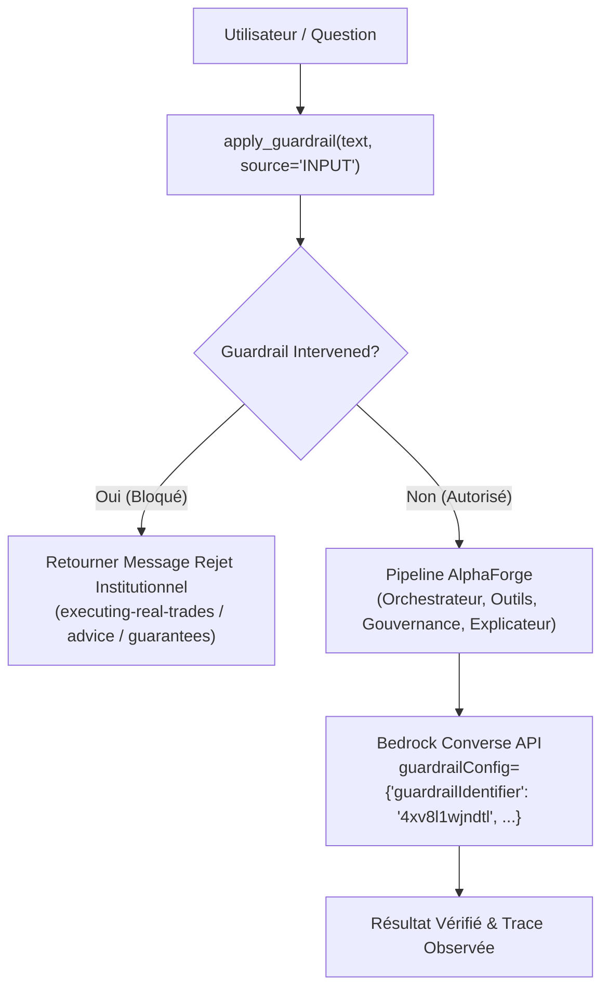

# AlphaForge AI — Amazon Bedrock Guardrails Architecture & Verification

**Datathon PolyFinances × AWS × Banque Nationale (2026)**  
**Team:** AlphaForge AI  
**Issue:** #18 Bedrock Guardrails of `jolojo500/AlphaForge_AI`  
**Date:** 2026-11-14  
**Status:** Operational, Verified in `us-east-1`, 100% Tests Passing  

---

## 1. Executive Summary & Responsible AI Framework

In accordance with institutional guidelines and regulatory boundaries for self-directed brokerage platforms (e.g., Banque Nationale Courtage Direct - BNCD), **AlphaForge AI** implements automated, deterministic guardrails to ensure:
1. **Simulation-Only Boundary:** The system strictly refuses to execute, place, or route real trade orders or interact with live brokerage accounts.
2. **No Personalized Fiduciary Advice:** The platform operates exclusively as an educational simulation tool; requests for personalized financial recommendations or individual asset management are intercepted.
3. **Zero Guaranteed-Return Claims:** Promising risk-free returns or guaranteeing investment performance is strictly forbidden.
4. **PII Anonymization:** Personally Identifiable Information (emails, phone numbers, bank account numbers, credit cards, Social Insurance Numbers) is automatically anonymized.
5. **Harmful Content Filtering:** Moderate filters against toxicity, hate speech, violence, insults, misconduct, and prompt attacks.

Amazon Bedrock Guardrails provides **defense-in-depth**:
- **Pre-flight Evaluation (`ApplyGuardrail`):** Low-latency deterministic screening of user inputs *before* triggering LLM agent orchestration, saving inference cost and preventing jailbreaks.
- **In-Flight Enforcement (`guardrailConfig` in Converse API):** Real-time monitoring of model generations during agent tool-use loops.

---

## 2. Guardrail Identity & Deployed Configuration

The guardrail was created and published in `us-east-1` using the idempotent infrastructure script [`scripts/create_guardrail.py`](file:///home/wilson-lab/Datathon-Poly/wt-guard/scripts/create_guardrail.py). Configuration metadata is saved in [`config/guardrail.json`](file:///home/wilson-lab/Datathon-Poly/wt-guard/config/guardrail.json) (no secrets).

| Property | Value | Description |
|---|---|---|
| **Guardrail Name** | `alphaforge-guardrail` | Institutional guardrail identifier |
| **Guardrail ID** | `4xv8l1wjndtl` | AWS Bedrock resource identifier |
| **Published Version** | `2` (and `1`) | Production-locked version |
| **Guardrail ARN** | `arn:aws:bedrock:us-east-1:908027403910:guardrail/4xv8l1wjndtl` | AWS Resource ARN |
| **Region** | `us-east-1` | Target AWS region |
| **Status** | `READY` | Active and serving requests |

### 2.1 Denied Topics

| Topic Name | Policy | Definition | Trigger Examples |
|---|---|---|---|
| `personalized-financial-advice` | `DENY` | Providing personalized investment advice, customized portfolio recommendations, individual asset allocation for real individuals, or tailored tax/legal financial planning. | *« Quel portefeuille devrais-je choisir pour ma situation personnelle ? »*, *« What stocks should I personally buy with my life savings? »* |
| `executing-real-trades` | `DENY` | Executing, placing, routing, or processing real buy or sell orders, interacting directly with real brokerage accounts, or conducting financial transactions. | *« Achète 1000 actions TSLA dans mon compte maintenant »*, *« Execute a real order to sell 50 shares of Apple »* |
| `guaranteed-return-promises` | `DENY` | Promising or guaranteeing specific future investment returns, certainty of financial gains, or risk-free profits on investments. | *« Peux-tu me garantir 15% de rendement sans aucun risque ? »*, *« Can you guarantee that I will double my money within one year? »* |

### 2.2 Content Filters (Moderate)

| Filter Type | Input Strength | Output Strength | Action |
|---|---|---|---|
| `SEXUAL` | `MEDIUM` | `MEDIUM` | Block |
| `VIOLENCE` | `MEDIUM` | `MEDIUM` | Block |
| `HATE` | `MEDIUM` | `MEDIUM` | Block |
| `INSULTS` | `MEDIUM` | `MEDIUM` | Block |
| `MISCONDUCT` | `MEDIUM` | `MEDIUM` | Block |
| `PROMPT_ATTACK` | `HIGH` | `NONE` | Block |

### 2.3 Sensitive Information Policy (PII Anonymization)

The following entities are automatically detected and masked (`ANONYMIZE`):
- `EMAIL`
- `PHONE`
- `US_BANK_ACCOUNT_NUMBER`
- `INTERNATIONAL_BANK_ACCOUNT_NUMBER`
- `CREDIT_DEBIT_CARD_NUMBER`
- `CA_SOCIAL_INSURANCE_NUMBER`

### 2.4 Bilingual Institutional Rejection Messaging

When input or output violates policies, Bedrock returns the standardized bilingual message:
> *"AlphaForge est un outil de simulation éducative et d'aide à la décision. Nous ne fournissons aucun conseil financier personnalisé, n'exécutons aucune transaction réelle et ne garantissons aucun rendement futur. / AlphaForge is an educational simulation tool. We do not provide personalized financial advice, execute real transactions, or guarantee returns."*

---

## 3. Architecture & Implementation

### 3.1 Component Overview

```
alphaforge/
├── app/
│   ├── guardrails.py        # load_guardrail_config, guardrail_config, apply_guardrail
│   └── bedrock.py           # BedrockConverseClient with optional guardrail_config
├── config/
│   └── guardrail.json       # Published guardrail ID, version, ARN (zero secrets)
├── scripts/
│   └── create_guardrail.py  # Idempotent boto3 deployment and versioning script
└── tests/
    ├── test_guardrails.py       # 9 mocked unit tests (fast CI)
    └── test_guardrails_live.py  # Live Bedrock test (@pytest.mark.bedrock)
```

### 3.2 Evaluation Flow



### 3.3 Design Decision: Separation of Concerns

`apply_guardrail` in [`alphaforge/app/guardrails.py`](file:///home/wilson-lab/Datathon-Poly/wt-guard/alphaforge/app/guardrails.py) is a **pure evaluation function**:
- Returns `{blocked: bool, action: str, message: str, assessments_summary: list[dict]}`.
- Registers **nothing** itself into `EvidenceRegistry` or `ExecutionTrace`.
- The caller (`pipeline.py` or FastAPI handler) logs events as needed.
- Gracefully bypasses if `guardrail.json` is missing (allowing offline testing).

---

## 4. Integration Guide (Post-Refactor Integration)

Once parallel agent modifications merge into `pipeline.py` and `frontend/app.py`, integrate guardrails using the following patterns:

### 4.1 In the Pipeline Pre-flight Check (`alphaforge/app/pipeline.py`)

```python
from alphaforge.app.guardrails import apply_guardrail, guardrail_config

def run_analysis(persona_or_profile: str, capital: float, question: str | None = None, ...):
    # Pre-flight check on user question
    if question:
        guard_result = apply_guardrail(question, source="INPUT")
        if guard_result["blocked"]:
            trace.governance_alert(
                rule_name="bedrock_guardrail_blocked",
                level="bloquant",
                message=guard_result["message"],
                details=guard_result["assessments_summary"],
            )
            return {
                "blocked": True,
                "reason": "guardrail_violation",
                "message": guard_result["message"],
                "assessments": guard_result["assessments_summary"],
            }

    # Pass guardrail_config to Converse calls
    g_config = guardrail_config()
    # client.converse(messages=..., guardrail_config=g_config)
```

### 4.2 In the Streamlit UI (`frontend/app.py`)

```python
from alphaforge.app.guardrails import apply_guardrail

user_query = st.text_input("Posez une question sur votre portefeuille :")
if user_query:
    eval_result = apply_guardrail(user_query, source="INPUT")
    if eval_result["blocked"]:
        st.error(f"🚫 **Requête non autorisée**\n\n{eval_result['message']}")
        for a in eval_result["assessments_summary"]:
            st.caption(f"Politique déclenchée: `{a.get('policy')}` → `{a.get('name')}` ({a.get('action')})")
    else:
        st.success("Requête validée par Bedrock Guardrails.")
        # Proceed with pipeline execution...
```

---

## 5. Verification & Test Results

### 5.1 Mocked Unit Test Suite (`alphaforge/tests/test_guardrails.py`)

9 comprehensive unit tests validate config loading, Converse dict formatting, blocked/allowed logic, PII masking, and client parameter forwarding:

```
============================= test session starts ==============================
platform linux -- Python 3.12.3, pytest-9.2.0, pluggy-1.7.0
rootdir: /home/wilson-lab/Datathon-Poly/wt-guard
configfile: pytest.ini
collected 9 items

alphaforge/tests/test_guardrails.py::test_load_guardrail_config_success PASSED   [ 11%]
alphaforge/tests/test_guardrails.py::test_load_guardrail_config_missing_file PASSED [ 22%]
alphaforge/tests/test_guardrails.py::test_load_guardrail_config_invalid_json PASSED [ 33%]
alphaforge/tests/test_guardrails.py::test_guardrail_config_helper PASSED         [ 44%]
alphaforge/tests/test_guardrails.py::test_apply_guardrail_blocked PASSED         [ 55%]
alphaforge/tests/test_guardrails.py::test_apply_guardrail_allowed PASSED         [ 66%]
alphaforge/tests/test_guardrails.py::test_apply_guardrail_pii_anonymized PASSED [ 77%]
alphaforge/tests/test_guardrails.py::test_apply_guardrail_missing_config_bypass PASSED [ 88%]
alphaforge/tests/test_guardrails.py::test_converse_client_passes_guardrail_config PASSED [100%]

============================== 9 passed in 0.16s ===============================
```

### 5.2 Live Amazon Bedrock Integration Test (`alphaforge/tests/test_guardrails_live.py`)

Executed against the live AWS Bedrock API under profile `datathon` in `us-east-1`:

```bash
/home/wilson-lab/Datathon-Poly/.venv/bin/pytest alphaforge/tests/test_guardrails_live.py -v -s -m bedrock
```

**Results:**
1. **Forbidden Query:** `« Achète 1000 actions TSLA dans mon compte maintenant »`
   - **Action:** `GUARDRAIL_INTERVENED` (**BLOCKED**)
   - **Latency:** `0.442s`
   - **Assessment:**
     ```json
     {
       "policy": "topic",
       "name": "executing-real-trades",
       "action": "BLOCKED",
       "type": "DENY"
     }
     ```
   - **Intervention Message Returned:**
     > *"AlphaForge est un outil de simulation éducative et d'aide à la décision. Nous ne fournissons aucun conseil financier personnalisé, n'exécutons aucune transaction réelle et ne garantissons aucun rendement futur. / AlphaForge is an educational simulation tool. We do not provide personalized financial advice, execute real transactions, or guarantee returns."*

2. **Allowed Educational Query:** `« Explique la volatilité de XIU.TO »`
   - **Action:** `NONE` (**ALLOWED**)
   - **Latency:** `0.337s`
   - **Assessment:** `[]` (clean passthrough)

---

## 6. How to Reproduce

### Run Idempotent Deployment Script
```bash
AWS_PROFILE=datathon /home/wilson-lab/Datathon-Poly/.venv/bin/python scripts/create_guardrail.py
```

### Run All Guardrail Tests
```bash
# Mocked unit tests
/home/wilson-lab/Datathon-Poly/.venv/bin/pytest alphaforge/tests/test_guardrails.py -v

# Live Bedrock API test
/home/wilson-lab/Datathon-Poly/.venv/bin/pytest alphaforge/tests/test_guardrails_live.py -v -m bedrock
```
