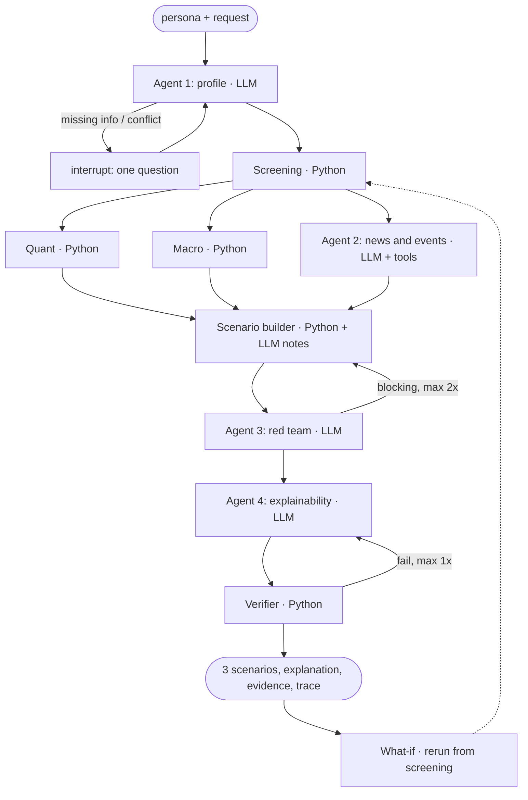

# AlphaForge AI — PRD

Datathon PolyFinances 2026 (BNCD + AWS). **Submission deadline: Sunday 2026-11-15, 23:59 ET.**
The AWS workshop account is destroyed Monday 2026-11-16 13:59, so the demo video must be recorded before then.

This document is the single source of truth for scope, contracts and who builds what.
Each GitHub issue points back to a section here. If an issue and this file disagree, this file wins; open a comment on the issue.

---

## 1. Product

A **second-opinion engine for investment decisions, simulation only.**

The user picks a persona (Amira, Mateo, Robert) and brings a request. Two request types, one pipeline:

- **build** — "100k CAD, 15+ years, I like tech and crypto but I want to be diversified."
- **judge** — "I want to put 25% of my portfolio in TSLA."

The system reads the profile, filters the 31-asset universe by the profile's hard constraints, analyses eligible assets with public data, builds **three comparable scenarios**, has them critiqued, and explains the result through the four workshop questions:

1. Which data did we use?
2. Why this choice?
3. What are the limits?
4. What would change the answer?

Every claim cites an evidence id pointing to a value, source, date and method. A deterministic verifier checks the cited evidence exists and the numbers match before anything is shown.

### Non-goals (from the official case — these are grading risks, not style choices)

- No personalised advice. Wording is "scenario 2 is the most consistent with the stated profile because ...", never "you should buy".
- No transactions, no real money. Everything is labelled simulation.
- No return forecasts. Historical risk and current context only.
- No exposure of model chain-of-thought. We show the node trace and the evidence.
- Facts, assumptions and fictional scenarios are always distinguished.
- Uncertainty is stated explicitly.

### Grading

Solution 20 · Agentic + explainability 20 · Data 20 · UX/UI 10 · AWS 15 (no real AWS use = ineligible) · Pitch 15.
The jury prefers "simple, focused, verifiable" and tests consistency: change one hypothesis or the persona, the answer must still make sense.

### Definition of done for the project

1. The three persona acceptance tests (§7) pass end to end from the UI.
2. One what-if change produces a coherent before/after comparison.
3. LLM calls go through Amazon Bedrock; data and caches live in S3; the backend is reachable on an AWS URL.
4. README, technical doc, one-pager and ~5 min video are delivered.

---

## 2. Architecture

LangGraph with one typed state. Fixed path, parallel analysis branch, one `interrupt()` for a clarifying question, two bounded retry loops. Node events are streamed to the UI: the graph trace **is** the explainability story.



- LLM nodes: Agent 1, Agent 2, Agent 3, Agent 4 (plus scenario notes and cheap classification). Everything else is deterministic Python.
- Only Agent 2 has real agency (small ReAct loop choosing what to look up).
- No LangSmith. Traces are logged by us (local JSON first, DynamoDB/CloudWatch when deployed).

### Stack

Backend: Python 3.12 · LangGraph · langchain-aws (`ChatBedrockConverse`) · Pydantic v2 · pandas, numpy, scipy · httpx · FastAPI (SSE) · pytest · `uv` for the environment.

Frontend: Vite · React · TypeScript · shadcn/ui (Tailwind) · npm. Lives in `frontend/`, built to `frontend/dist`, served as static files by the FastAPI app in production (one container). In development, Vite runs on its own port and FastAPI allows it through CORS.

Reference material for prompts and wording: the BNCD workshop deck "Comprendre l'investisseur avant de bâtir la solution" (FR and EN) in `Datathon2026/`. It is the source of the four questions, the six risk types (market, credit, liquidity, rates/inflation, currency, concentration), tolerance vs capacity, the data checks (source, date, currency, total return vs price, publication vs observation date) and the ETF overlap example (XSP vs ZEQT).

### Models and AWS

| Use | Model id (env var) |
|---|---|
| Agents 1, 3, 4, scenario notes | `global.anthropic.claude-sonnet-5-5` (`AF_MODEL_MAIN`) |
| Agent 2 classification | `global.anthropic.claude-haiku-5-5` (`AF_MODEL_FAST`) |

Both inference profiles were confirmed present in the workshop account (us-east-1) on 2026-11-14. Sonnet 5.5 rejects forced `tool_choice`: ask for JSON in the prompt and validate with Pydantic rather than relying on `with_structured_output`.

| Service | Why |
|---|---|
| Bedrock | Foundation models. This alone satisfies AWS eligibility. |
| S3 | Starter data + cached news and ETF holdings, shared and versioned. |
| DynamoDB | Run traces (and checkpoints if time allows), so the service is auditable. |
| App Runner (fallback: EC2) | Hosts one container: the FastAPI backend, which also serves the built React frontend. |
| CloudWatch | Logs. |

Credentials always come from the environment (`AWS_PROFILE` / standard env vars, region `us-east-1`). Never commit credentials. Workshop credentials are temporary: on `ExpiredToken`, get fresh ones from the Event Dashboard.

---

## 3. Contracts (frozen)

These are what make parallel work possible. **Only the orchestrator edits `alphaforge/state.py`, `alphaforge/evidence.py`, `alphaforge/graph.py`, `alphaforge/tracing.py`, `alphaforge/config.py` and `pyproject.toml`.** (Need a dependency? Ask in your issue; it is added within minutes.) Need a change? Comment on your issue with the exact diff you want; do not work around it locally.

### 3.1 Repository layout and ownership

```
alphaforge/
  state.py            orchestrator   Pydantic models (below)
  evidence.py         orchestrator   EvidenceRegistry
  graph.py            orchestrator   build_graph(), run(), stream_run(), resume_run(), get_state()
  tracing.py          orchestrator   @traced(name) decorator
  personas.py         Track B        persona hypothesis table (created by the skeleton)
  config.py           orchestrator   env settings (model ids, paths, bucket)
  llm.py              Track B        get_llm(kind), call_json(prompt, schema)
  data/
    provider.py       Track A        DataProvider protocol
    csv_provider.py   Track A        starter CSVs (default)
    yfinance_provider.py  Track A    same protocol over yfinance (P2, see 5.3)
    holdings.py       Track A        cached ETF holdings loader
  nodes/
    screening.py      Track A
    quant.py          Track A
    macro.py          Track A
    scenarios.py      Track A        (LLM notes hook provided by Track B)
    profile.py        Track B        Agent 1
    events.py         Track B        Agent 2
    red_team.py       Track B        Agent 3
    explain.py        Track B        Agent 4
    verifier.py       Track B
  tools/              Track B        news.py, search.py
  whatif.py           Track C
  api/server.py       Track C        FastAPI + SSE
  trace_store.py      Track C        local JSON / DynamoDB
frontend/             Track C        Vite + React + TypeScript + shadcn/ui
  src/api.ts                         typed client for the routes in 6 (fetch + EventSource)
  src/components/                    one component per block of the page in 6
  package.json, vite.config.ts, tsconfig.json
infra/                Track C        Dockerfile (builds frontend, serves it from FastAPI), deploy scripts
data/cache/           A (holdings/), B (news/)   committed JSON fixtures
tests/
  test_<module>.py    owner of the module
  fixtures/           shared, append-only
  test_e2e_personas.py  orchestrator
Datathon2026/         read-only starter material
```

The skeleton ships every node as a **stub that returns valid fake data**, so the graph, API and UI run end to end from day one. Your job is to replace your stub's body without changing its signature.

### 3.2 Node signature

```python
from alphaforge.tracing import traced

@traced("quant")
def quant_node(state: GraphState) -> dict:
    """Return ONLY the state keys this node updates, plus `summary`."""
    return {"evidence": reg.items(), "summary": "Statistiques de risque calculées."}
```

- Nodes never mutate `state`. They return a partial update; LangGraph merges it.
- `evidence`, `events`, `exclusions`, `trace` use merge reducers, so parallel nodes can all write them.
- `@traced` turns the returned `summary` into one trace entry `{"node", "started_at", "ended_at", "summary"}`. `summary` is one user-facing sentence in French, never model reasoning. Keep the function name and the decorator; `graph.py` imports `<name>_node` from each module.
- `retries` is a merged dict: return `{"retries": {"explain": n + 1}}`.
- `tests/test_graph_stub.py` is the contract test. It must stay green when your real node replaces the stub.
- A node must not raise on bad upstream data. Degrade, record the problem in `trace` and in an `assumption` evidence entry.

### 3.3 State

```python
class Profile(BaseModel):
    persona: Literal["amira", "mateo", "robert"]
    objective: str
    horizon_years: int
    risk_tolerance: Literal["low", "low_moderate", "moderate", "high"]
    risk_capacity: Literal["low", "moderate", "high"]      # distinct from tolerance
    constraints: list[str]      # hard: "no_crypto", "esg_only", "no_controversies"
    preferences: list[str]      # soft: "likes_tech", "wants_diversification"
    budget_cad: float | None
    request_type: Literal["build", "judge"]
    requested_idea: dict | None # {"ticker": "TSLA", "weight": 0.25}
    excluded_tickers: list[str] # set by what-if, applied by screening
    conflicts: list[str]        # human-readable contradictions found by Agent 1
    clarification_needed: str | None

class Evidence(BaseModel):
    id: str                     # see 3.4
    value: float | str | dict
    source: str                 # "prices_daily.csv", "Finnhub", "Vanguard ESGV holdings"
    date: date
    date_kind: Literal["observation", "publication"]
    url: str | None
    method: str                 # "annualised std of daily log returns, CAD, 2021-11..2026-11"
    confidence: Literal["fact", "assumption", "fictional"]

class Scenario(BaseModel):
    name: Literal["as_requested", "capped", "profile_baseline"]
    weights: dict[str, float]   # ticker -> weight, sums to 1.0
    metrics: dict[str, str]     # metric name -> evidence id
    notes: list[str]

class GraphState(BaseModel):
    as_of_date: date
    persona: str
    request_text: str
    profile: Profile | None
    eligible_universe: list[str]
    exclusions: list[dict]      # {"ticker", "reason", "evidence_id"}
    evidence: dict[str, Evidence]
    events: list[dict]          # classified news items
    scenarios: list[Scenario]
    objections: list[dict]      # {"scenario", "objection", "evidence", "severity"}
    explanation: dict | None    # schema in 5.9
    verification: dict | None   # {"passed": bool, "errors": [...]}
    retries: dict[str, int]
    trace: list[dict]
```

Scenario metric keys (fixed, all three scenarios carry all of them):
`volatility_ann`, `max_drawdown`, `stress_2022`, `top_weight`, `sector_concentration_hhi`, `us_exposure`.

### 3.4 Evidence ids

Parallel nodes cannot share one counter, so ids are **namespaced per node**: `E` + one letter + number.

| Prefix | Node |
|---|---|
| `ES` | screening |
| `EQ` | quant |
| `EM` | macro |
| `EN` | news / events |
| `EP` | scenario builder (portfolio metrics) |

```python
reg = EvidenceRegistry(prefix="EQ")
eid = reg.add(value=0.213, source="prices_daily.csv", date=as_of, date_kind="observation",
              url=None, method="annualised std of daily log returns, CAD", confidence="fact")
return {"evidence": reg.items()}
```

Rules: every Quant / Macro / Event / Screening output goes through the registry. **Nothing numeric reaches an LLM prompt without an id.** Ids are deterministic for a given input (stable ordering), so two runs produce the same ids.

### 3.5 Quant evidence lookup

Later nodes need to find a number without parsing `method` strings, so quant and macro evidence values are dicts with a fixed `metric` key:

```python
{"metric": "volatility_ann", "ticker": "TSLA", "value": 0.58, "unit": "ratio"}
{"metric": "correlation", "tickers": ["SPY", "QQQ"], "value": 0.93}
{"metric": "policy_rate_ca", "value": 2.25, "unit": "%"}
```

`alphaforge/evidence.py` provides `find(evidence, metric=..., ticker=...)`, `find_one(...)`, `numeric(ev)` and `EID_RE` (the id regex).

### 3.6 Running the graph (for the API, the UI and tests)

```python
from alphaforge.graph import initial_state, stream_run, resume_run, run, get_state

for ev in stream_run(initial_state("robert", text), thread_id):   # as_of_date optional
    # {"type": "trace", "entry": {...}} | {"type": "interrupt", "question": str} | {"type": "final", "state": GraphState}
    ...
for ev in resume_run(answer, thread_id): ...                      # after an interrupt
state = run("robert", text, profile=changed_profile)              # what-if: a given profile skips Agent 1
```

Local setup: `uv sync`, then `uv run pytest -q`, `uv run ruff check .`, `uv run python -m alphaforge.graph robert`. Copy `.env.example` to `.env` for the variables.
Frontend (Track C): `cd frontend && npm install && npm run dev` with the API running on `uv run uvicorn alphaforge.api.server:app --reload`.

---

## 4. How we work

### Roles

| Role | Who | Scope |
|---|---|---|
| Orchestrator | Claude (via @LyWilson) | Skeleton, contracts, graph wiring, review, merge, integration tests, final docs |
| Track A — data and numbers | @jolojo500 | Data provider, quant, macro, screening, scenario builder |
| Track B — LLM agents and governance | @d3mh4 | Bedrock client, Agents 1–4, verifier |
| Track C — product and AWS | @rbhunjun22 | API, UI, what-if, trace store, deployment |

Each track is worked by one agent reading the issue board. An agent only picks issues carrying its own `track:*` label.

### Issue lifecycle

1. Pick the lowest-numbered open issue of your track whose "Depends on" items are merged (stubs count: you can always build against the stub).
2. Branch from fresh `main`: `track-a/<issue>-<slug>` (or `track-b/`, `track-c/`).
3. Stay inside your own files (§3.1). Write the tests named in the issue.
4. `uv run pytest -q` and `uv run ruff check .` must pass locally.
5. Open a PR titled `[A-3] Quant metrics` with `Closes #<n>` in the body and a short "how I verified" note. A non-draft PR means **in review**. Use a draft PR while still working.
6. The orchestrator reviews, runs the full suite plus the persona e2e test, and squash-merges. If changes are needed it comments on the PR; fix on the same branch.
7. After a merge, rebase any branch you still have open.

### Rules

- Small PRs, one issue each. Do not bundle.
- Never push to `main`. Never edit another track's files; if you need something from them, comment on their issue and code against the stub meanwhile.
- No network in unit tests. LLM and HTTP calls are mocked or replayed from `tests/fixtures/` and `data/cache/`. Tests that need Bedrock are marked `@pytest.mark.live` and skipped by default.
- No secrets in the repo. API keys via env vars: `FINNHUB_API_KEY`, `TAVILY_API_KEY`.
- User-facing text in the product is **French first** (jury is BNCD/PolyFinances), with English fallback; code, comments and commits in English.
- If blocked for more than 30 minutes, comment on the issue and move to your next one.

### Milestones

| Milestone | Due (ET) | Exit criterion |
|---|---|---|
| M0 Skeleton | Sun 01:00 | Stub graph runs end to end, tests green, everyone can branch |
| M1 Core nodes | Sun 10:00 | Deterministic nodes real; Agent 1 and 4 on Bedrock; UI shows a stub run |
| M2 End to end | Sun 16:00 | Three personas pass from the UI with real nodes; what-if works |
| M3 Ship | Sun 21:00 | Deployed on AWS, code freeze, docs done. 21:00–23:59 is video, one-pager and submission only |

Priorities: `P0` = the demo breaks without it. `P1` = graded value. `P2` = cut first if late.

---

## 5. Node specifications

### 5.1 Agent 1 — Profile (LLM) · Track B

- **Why.** A decision starts with the person. Horizon ≠ age ≠ tolerance, and tolerance ≠ capacity.
- **In.** `persona`, `request_text`, `as_of_date`. **Out.** `profile`.
- **Functions.** `extract_profile()`, `detect_conflict()`, `needs_clarification()`.
- **Routing.** Essential field missing, or the request contradicts the profile in a way that needs the user → `interrupt()` with ONE targeted question, at most one per run. A conflict that does not need an answer (Robert + TSLA) is recorded in `profile.conflicts` and the run proceeds.
- **Invariant.** The node always either sets `profile` or calls `interrupt()`. Returning without a profile (for example after a failed JSON parse) makes the graph loop on this node; on a parse failure, fall back to the persona table and record an `assumption` in `conflicts`.
- **Persona table** (§7) is passed in the prompt; the model fills gaps from the free text.
- **Tests.** Three persona fixtures give the expected `Profile` with no question; Robert + TSLA sets `request_type="judge"`, `requested_idea={"ticker":"TSLA","weight":0.25}` and a non-empty `conflicts`.

### 5.2 Screening (Python) · Track A

- **Why.** Constraints are hard rules: code, so they cannot be argued away. One reason per exclusion.
- **In.** `profile`, universe (`assets_universe.csv`, 31 assets). **Out.** `eligible_universe`, `exclusions` (each with an `ES` evidence id).
- **Functions.** `apply_constraints()`, `esg_exclusions()`, `class_and_geo_filters()`.
- **ESG.** The dataset has no ESG scores. "Is this company held by Vanguard ESGV?" is a sourced, dated screen for Mateo, from the cached holdings file. Energy names (ENB, CNQ, XOM) are the real candidates. Canadian names are not in ESGV's US universe: do not exclude them for absence; record an `assumption` evidence entry saying the screen does not cover them.
- **Pitfall.** Crypto is an exclusion for Robert and Mateo; for Amira it is a cap applied by the scenario builder.
- **Tests.** Mateo → no crypto, ESG screen applied, each exclusion has a reason; Robert → no crypto; Amira → all 31 eligible.

### 5.3 Quant (Python) · Track A

- **Why.** Numbers come from data, never from the model.
- **In.** `eligible_universe`, `as_of_date`. **Out.** `EQ` evidence: per-asset and pairwise.
- **Functions.** `load_prices()` (calendar alignment, FX → CAD), `returns()`, `volatility()`, `max_drawdown()`, `correlation()`, `concentration()`, `etf_overlap()`, `stress_2022()`. Each also callable on a weights dict, so the scenario builder reuses them for portfolios.
- **Data pitfalls** (starter README):
  - Crypto trades 7 days a week (1,827 rows vs 1,255). Align on the equity calendar and state it in `method`.
  - US assets in USD, `.TO` in CAD. Convert to CAD with `fx_usdcad_daily.csv`; forward-fill FX gaps on Canadian holidays.
  - Use `adj_close` for returns. Do not re-apply splits. CNQ.TO has a 1.021 pseudo-split on 2022-08-22.
  - Survivorship bias: record it once as a limit (`assumption`).
  - Only data ≤ `as_of_date`.
- **Tests.** Hand-computed checks (e.g. SPY 2022 max drawdown in CAD); changing `as_of_date` changes the window; no row after the as-of date is read.
- **Data sources.** `CsvProvider` over the starter files is the default and what the demo runs on: frozen data means identical numbers at every run and no rate limit on stage. `YFinanceProvider` (A-7, P2) implements the same `DataProvider` protocol over yfinance, essentially the starter's `build_dataset.py`, selected with `AF_DATA_PROVIDER=csv|yfinance`. Its value is the "refresh the dataset" story for the pitch, not the demo (the CSVs end on 2026-11-12). All as-of, calendar and FX logic lives above the provider so it applies to both.

### 5.4 Macro (Python) · Track A

- **Why.** Publication date ≠ observation date. Monthly series are dated to the reference month; February CPI is only known mid-March.
- **In.** `as_of_date`. **Out.** `EM` evidence: policy rate, 2y/10y yields, CPI, unemployment (CA and US) as known on the as-of date.
- **Functions.** `rates_as_of()`, `inflation_as_of()`, a publication-lag table per series.
- **Test.** `inflation_as_of(2024-03-05)` returns January's value, not February's.

### 5.5 Agent 2 — News and events (LLM + tools) · Track B

- **Why.** Prices do not show lawsuits, strikes, regulatory bans or earnings surprises. The only node with agency.
- **In.** `eligible_universe`, `profile.requested_idea`, `as_of_date`. **Out.** `events` + `EN` evidence.
- **Tools** (plain Python functions): `fetch_company_news(ticker, from, to)` (Finnhub free tier), `web_search(query)` (Tavily free tier), `fetch_etf_holdings(ticker)` (wraps Track A's loader).
- **Classification** `classify_item()` on Haiku with a strict JSON schema: relevant, fact vs opinion, risk type (market, credit, liquidity, rates_inflation, currency, concentration, controversy), material.
- **Rules.** Drop items dated after the as-of date. Store the provider's publication timestamp, not fetch time. News feeds the present-day view only, never the historical stress test. **Cache every fetched item as JSON in `data/cache/news/`** so a rate limit cannot break the demo; the demo runs from cache by default (`AF_NEWS_MODE=cache|live`).
- **Budget.** At most 8 tool calls and 40 classified items per run. Focus on the requested ticker and the top holdings, not all 31 assets.
- **Classification eval.** Hand-label ~50 cached news items (`tests/fixtures/news_labels.json`: relevant, kind, risk_type, material). The classifier's accuracy on them is a test and a paragraph in the technical document. The backend is one function `classify_item()`, so a second backend can be compared later if someone has access to one.
- **Tests.** With a cached fixture, the same classified list twice; items after the as-of date dropped.

### 5.6 Evidence registry · Orchestrator

See §3.4 and §3.5.

### 5.7 Scenario builder (Python + LLM notes) · Track A

- **Why.** The "propose" step, made structured: a comparison the jury can verify.
- **In.** `profile`, `eligible_universe`, `evidence`, `objections` (on a retry). **Out.** three `Scenario` objects + `EP` evidence.
- **Scenarios.**
  1. `as_requested` — the user's idea as stated (judge), or an unconstrained risk-based allocation (build). For judge, the rest of the portfolio is the profile baseline scaled to the remaining weight.
  2. `capped` — the idea with the profile's caps applied.
  3. `profile_baseline` — min-variance or risk parity (scipy) under the profile's constraints. No return forecasts anywhere.
- **Caps table** (one module-level dict, cited as `assumption` evidence):

  | Persona tolerance | Single stock | Crypto total | Equity total |
  |---|---|---|---|
  | high (Amira) | 10% | 10% | 100% |
  | moderate (Mateo) | 7% | 0% | 70% |
  | low_moderate (Robert) | 5% | 0% | 40% |

- **Functions.** `optimize()`, `build_scenarios()`, `scenario_metrics()`.
- **LLM part.** Only drafts `notes` per scenario, citing ids; Track B supplies `draft_notes(scenario, evidence)`. Until then, notes are templated strings.
- **Test.** Robert + TSLA 25% → `max_drawdown` of `as_requested` > `capped` ≥ `profile_baseline`. Weights sum to 1, no excluded ticker appears.

### 5.8 Agent 3 — Red team (LLM, no tools) · Track B · P2

- **Why.** A hostile second reading catches what rules cannot express (Amira's "diversified" portfolio being 80% US through overlap).
- **Out.** `objections`: `{scenario, objection, evidence, severity: "blocking"|"warning"}`. Blocking → back to the scenario builder, max 2 loops.
- **Status.** Build last. If it adds nothing on the three personas, it stays a pass-through stub. Until then the stub returns no objections.
- **Loop contract.** The node must return `{"retries": {"red_team": n + 1}}` on every pass (the stub already does); `graph.py` uses that counter to stop the loop after `MAX_RED_TEAM_LOOPS`. On a retry, the scenario builder reads `objections` and must change something (tighten a cap, drop a ticker) or the loop is wasted.

### 5.9 Agent 4 — Explainability (LLM) · Track B

- **Why.** The jury grades this. It does NOT collapse three scenarios into one: it explains the comparison and states which is most consistent with the stated profile.
- **In.** scenarios, objections, evidence, profile, exclusions, and on a retry the verifier's error list.
- **Output schema** (French keys, fixed):

```json
{
  "resume": "...",
  "quelles_donnees": [{"claim": "...", "evidence": ["EQ1", "EM4"]}],
  "pourquoi_ce_choix": [{"claim": "...", "evidence": ["EP7"]}],
  "limites": [{"claim": "...", "evidence": ["EQ2"]}],
  "ce_qui_changerait_la_reponse": [{"claim": "...", "evidence": []}],
  "incertitude": "...",
  "scenario_le_plus_coherent": "capped",
  "avertissement": "Simulation éducative. Aucun conseil personnalisé."
}
```

- **Wording.** Consistency language, not advice. No future returns. Facts, assumptions and fictional scenarios distinguished.
- **Tests.** Mocked LLM: schema validates; a malformed reply is repaired or fails cleanly. Live test (marked) on Robert.

### 5.10 Verifier (Python) · Track B

- **Why.** A model will invent a number eventually. The LLM audits reasoning, code audits numbers.
- **Functions.** `check_eids()` (every cited id exists), `check_numbers()` (every number in a claim appears in its cited evidence within tolerance: 1% relative, or matching after percent/ratio conversion and rounding), `check_wording()` (FR + EN regex list for advice and forecast phrasing: "vous devriez acheter", "you should buy", "garanti", "will return", ...), `check_sections()` (four questions + uncertainty + disclaimer present and non-empty).
- **Routing.** Fail → regenerate Agent 4 once with the error list. Fail twice → `verification.passed=false` and the UI shows the failure instead of a bad answer.
- **Tests.** One fixture per check that fails for exactly that reason, and one clean explanation that passes.

### 5.11 What-if (Python + UI) · Track C

- **Why.** Question 4 turned into something the user can do, and the jury's consistency test done on stage.
- **What.** The user changes ONE hypothesis (horizon, budget, tolerance, exclude an asset, as-of date). Full rerun with the modified profile, skipping Agent 1; the UI shows old vs new side by side.
- **Functions.** `apply_change(profile, field, value)`, `rerun(state, change)`, `diff_scenarios(old, new)`.
- Plain rerun first. Checkpoint resume is not needed.

---

## 6. Product surface · Track C

### API (`alphaforge/api/server.py`)

| Route | Purpose |
|---|---|
| `POST /runs` `{persona, request_text, as_of_date?}` | Starts a run, returns `run_id` |
| `GET /runs/{id}/events` | SSE stream of trace entries, then `interrupt` or `final` |
| `POST /runs/{id}/answer` `{text}` | Resumes after the clarifying question |
| `POST /runs/{id}/whatif` `{field, value}` | Returns a new `run_id` linked to the parent |
| `GET /runs/{id}` | Final state as JSON |
| `GET /health` | For the load balancer |
| `GET /personas` | Persona table (label, hypotheses, example request) for the picker |

- CORS: allow the Vite dev origin (`http://localhost:5173`) in development.
- Production: if `frontend/dist` exists, mount it at `/` (static files, SPA fallback to `index.html`). API routes stay under `/runs`, `/personas`, `/health`.
- SSE events are the ones in 3.6, serialised as JSON: `{"type": "trace", "entry": {...}}`, `{"type": "interrupt", "question": "..."}`, `{"type": "final", "run_id": "..."}` (the client then fetches `GET /runs/{id}`).

### UI (`frontend/`, Vite + React + TypeScript + shadcn/ui)

One page, top to bottom: simulation banner → persona picker with the persona's hypotheses → request box with one example per persona → **live node trace** → clarifying question if any → three scenario cards side by side (weights chart + the six metrics, the most consistent one highlighted) → explanation as four sections, each claim with clickable evidence chips → evidence table (id, value, source, date, method, fact/assumption/fictional) → excluded assets with reasons → what-if controls and before/after diff.

The disclaimer is always visible. Verification failure is shown explicitly.

Rules for the frontend:

- One component per block above, in `frontend/src/components/`. Types for the API payloads in `frontend/src/types.ts`, mirroring `alphaforge/state.py` (hand-written; keep them in sync when the contract changes).
- Live trace through `EventSource` on `GET /runs/{id}/events`.
- French UI text. shadcn/ui components only; no second component library.
- `npm run lint` and `npm run build` must pass; CI runs both. No frontend unit tests required: the acceptance is a screenshot in the PR plus the three personas running from the browser against the stub backend.
- Scope is exactly the list above. Anything else is P2.

---

## 7. Personas and acceptance tests

| Persona | Profile hypotheses | Expected behaviour |
|---|---|---|
| Amira, 26 | horizon 15+, tolerance high, capacity high, likes AI/tech/crypto, wants diversification | All assets eligible; crypto capped; SPY/QQQ overlap flagged; three scenarios with different concentration |
| Mateo, 41 | horizon 8–12, tolerance moderate, ESG, avoid controversies, balance | No crypto; ESG screen via ESGV holdings; controversies from Agent 2; balanced baseline |
| Robert, 59 | horizon 3–5, tolerance low-to-moderate, capital preservation, tempted by a volatile stock | Conflict detected; `as_requested` vs `capped` vs baseline with 2022 drawdown comparison; consistency wording, never a refusal |

Canonical requests (used by fixtures, the e2e test and the demo):

- Amira: "J'ai 100 000 $ CAD, un horizon de 15 ans et plus. J'aime la techno et la crypto mais je veux rester diversifiée."
- Mateo: "Je veux un portefeuille équilibré et responsable sur environ 10 ans, sans entreprises controversées."
- Robert: "Je veux mettre 25 % de mon portefeuille dans TSLA."

Demo (5 min): Robert asks about TSLA → challenged with the capped alternative. Amira asks for a proposal → crypto capped, overlap flagged. Move one what-if control → the answer changes coherently.

---

## 8. Risks

| Risk | Mitigation |
|---|---|
| Workshop AWS credentials expire mid-demo | Record the video early Sunday evening; keep a cached run the UI can replay |
| News API rate limits | Cache-first by default, committed fixtures |
| LLM returns invalid JSON | Pydantic validation + one repair retry in `call_json()` |
| Merge conflicts across tracks | File ownership (§3.1), frozen contracts, small PRs |
| App Runner blocked in the workshop account | Fall back to EC2 + Docker; decide by Sun 14:00 |
| Scope | Red team, DynamoDB checkpoints and the yfinance provider are P2 and cut first |
| Frontend time | Scope is exactly PRD 6; shadcn/ui only; build against the stub backend from the first hour so the API contract is exercised early |
