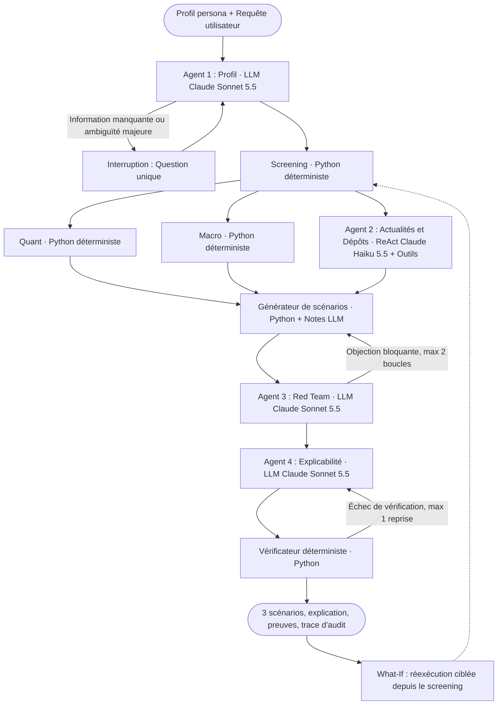
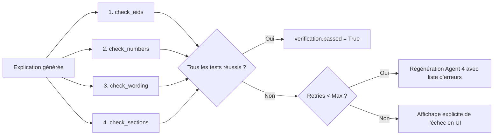
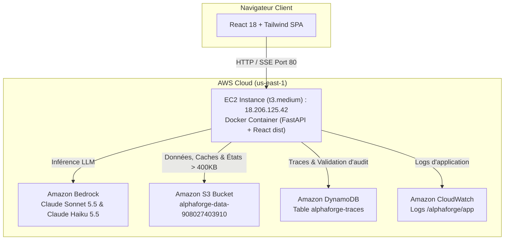

# AlphaForge AI — Documentation Technique

Document technique de référence pour le projet **AlphaForge AI** (Datathon PolyFinances 2026 — BNCD & AWS).  
Ce document détaille l'architecture du système, la formalisation mathématique et informatique des nœuds, le modèle de preuves déterministe, les règles de vérification, la rigueur méthodologique du traitement des données, ainsi que les résultats empiriques obtenus sur les personas de test.

---

## 1. Architecture du Graphe LangGraph

AlphaForge AI est articulé autour d'un pipeline d'orchestration multi-agents modélisé sous la forme d'un graphe d'état typé avec **LangGraph** ([alphaforge/graph.py](../alphaforge/graph.py)).

Le graphe repose sur une exécution déterministe avec une branche d'analyse parallèle, une interruption possible pour clarification humaine (`interrupt()`), et deux boucles de reprise bornées.

### 1.1 Spécification détaillée des nœuds

| Nœud | Nature | Fichier source | Entrées principales | Sorties d'état | Rôle et spécifications |
|---|---|---|---|---|---|
| **Agent 1 : Profile** | LLM (`claude-sonnet-5-5`) | [alphaforge/nodes/profile.py](../alphaforge/nodes/profile.py) | `persona`, `request_text`, `as_of_date` | `profile` (`Profile`) | Extrait l'intention (`build` vs `judge`), le budget, l'horizon temporel et les préférences. Détecte les contradictions (ex. allocation supérieure au plafond de tolérance). Si une information essentielle manque, déclenche un `interrupt()` pour poser une question unique. Si le modèle échoue, repli déterministe sur les tables du persona. |
| **Screening** | Code déterministe Python | [alphaforge/nodes/screening.py](../alphaforge/nodes/screening.py) | `profile`, univers (31 actifs) | `eligible_universe`, `exclusions` (`ES...`) | Applique sans dérogation les règles d'exclusion matérielles : classes d'actifs (crypto, obligations), géographie (Canada, US), et critères ESG (exclusion systématique des titres pétroliers et énergétiques pour Mateo via le secteur et recoupement avec les détentions Vanguard ESGV). Chaque exclusion génère une preuve `ES`. |
| **Quant** | Code déterministe Python | [alphaforge/nodes/quant.py](../alphaforge/nodes/quant.py) | `eligible_universe`, `as_of_date` | `evidence` (`EQ...`) | Calcule rigoureusement sur les prix historiques en CAD (`adj_close`) : rentabilités quotidiennes, volatilité annualisée, perte maximale historique (*max drawdown*), corrélations par paires, concentration sectorielle (HHI), exposition géographique et test de résistance historique 2022. |
| **Macro** | Code déterministe Python | [alphaforge/nodes/macro.py](../alphaforge/nodes/macro.py) | `as_of_date` | `evidence` (`EM...`) | Extrait les indicateurs macroéconomiques connus à la date d'analyse : taux directeurs (BoC, Fed), rendements obligataires 2 ans et 10 ans, IPC canadien et américain, et taux de chômage américain. Applique les délais réels de publication pour exclure tout biais de prévoyance. |
| **Agent 2 : Events** | Règles déterministes + LLM (`claude-haiku-5-5`) en repli + Outils | [alphaforge/nodes/events.py](../alphaforge/nodes/events.py) | `eligible_universe`, `profile.requested_idea`, `as_of_date` | `events`, `evidence` (`EN...`) | Recherche les dépôts réglementaires officiels SEC EDGAR (Form 8-K, 10-Q, 10-K, proxy statements) et les actualités. Budget strict : maximum 6 appels d'outils et 12 éléments retenus. Chaque événement est filtré à la date de publication et classifié avec Claude Haiku 5.5 (pertinence, fait/opinion, type de risque, matérialité). |
| **Scenario Builder** | Code déterministe Python + Notes LLM | [alphaforge/nodes/scenarios.py](../alphaforge/nodes/scenarios.py) | `profile`, `eligible_universe`, `evidence`, `objections` | `scenarios`, `evidence` (`EP...`) | Construit trois portefeuilles comparables (`as_requested`, `capped`, `profile_baseline`) par optimisation sous contraintes (variance minimale bornée avec plancher d'actions et moindres carrés). Calcule les métriques de portefeuille pour chaque scénario. Rédige les notes explicatives sourcées. |
| **Agent 3 : Red Team** | LLM (`claude-sonnet-5-5`) | [alphaforge/nodes/red_team.py](../alphaforge/nodes/red_team.py) | `scenarios`, `profile`, `evidence` | `objections`, `retries["red_team"]` | Relecture contradictoire des scénarios pour détecter ce que les règles ne voient pas : chevauchement de FNB (Amira : QQQ détient déjà AAPL, MSFT, GOOGL, NVDA), FNB large non filtré ESG dans le portefeuille de Mateo (XIU.TO), concentration en fonds obligataires sensibles aux taux (Robert). Chaque objection doit citer une preuve existante et passer les mêmes contrôles de nombres et de formulation que l'explication. Une objection bloquante renvoie une fois au constructeur de scénarios ; le second passage conserve les objections comme avertissements sans nouvel appel au modèle. Désactivable avec `AF_RED_TEAM=off` (environ 35 s de moins par exécution). |
| **Agent 4 : Explain** | LLM (`claude-sonnet-5-5`) | [alphaforge/nodes/explain.py](../alphaforge/nodes/explain.py) | `scenarios`, `objections`, `evidence`, `profile`, `exclusions` | `explanation` (schéma JSON) | Rédige la synthèse comparative en français structurée selon les quatre questions de l'atelier BNCD. Chaque affirmation cite obligatoirement des identifiants de preuve. Utilise exclusivement un langage de cohérence avec le profil, sans aucun conseil ni prévision. |
| **Verifier** | Code déterministe Python | [alphaforge/nodes/verifier.py](../alphaforge/nodes/verifier.py) | `explanation`, `evidence` | `verification` (`passed`, `errors`) | Valide l'explication générée par 4 vérifications formelles : existence des preuves citées, concordance numérique stricte (tolérance 1 %), absence de formulations de conseil/promesse (regex FR/EN), et présence intégrale des sections requises. Autorise 1 régénération en cas d'erreur. |
| **What-If** | Code Python | [alphaforge/whatif.py](../alphaforge/whatif.py) | `profile`, modification de paramètre | `run_id`, comparaison différentielle | Permet à l'utilisateur de modifier une variable (horizon, budget, tolérance au risque, exclusion d'un actif) et relance instantanément le pipeline depuis le screening en sautant l'Agent 1. |

---

## 2. Modèle d'État et Registre de Preuves (*Evidence Model*)

### 2.1 Schéma des données (`alphaforge/state.py`)

Le graphe LangGraph s'appuie sur des modèles Pydantic v2 assurant un typage strict :
- `Profile` : formalise les objectifs, l'horizon d'investissement (en années), la tolérance au risque (`low`, `low_moderate`, `moderate`, `high`), la capacité financière distincte de la tolérance, les contraintes dures, les préférences et les éventuels conflits détectés.
- `Evidence` : représente un fait atomique vérifié.
- `Scenario` : structure chaque scénario (`as_requested`, `capped`, `profile_baseline`) avec son dictionnaire de pondérations $\sum w_i = 1{,}0$, son vecteur de métriques normalisées, et ses notes d'audit.
- `GraphState` : état global du graphe contenant la date d'analyse (`as_of_date`), l'univers éligible, les exclusions, le registre de preuves, les actualités classifiées, les scénarios, l'explication finale et l'état de vérification.

### 2.2 Espaces de noms du registre de preuves (`EvidenceRegistry`)

Afin d'éviter tout conflit de concurrence entre nœuds s'exécutant en parallèle, chaque identifiant de preuve est préfixé de manière déterministe par le nœud émetteur :

| Préfixe | Nœud d'origine | Domaine couvert | Exemple de métrique ou d'observation |
|---|---|---|---|
| `ES` | Screening | Exclusions d'actifs et hypothèses d'univers | `ES1` : Exclusion de BTC-USD pour profil interdisant les cryptoactifs. |
| `EQ` | Quant | Risques individuels, corrélations, métriques historiques | `EQ98` : Volatilité annualisée de TSLA (58,5 %). |
| `EM` | Macro | Indicateurs économiques, taux et inflation | `EM1` : Taux directeur de la Banque du Canada connu au 2026-11-12 (2,5 %). |
| `EN` | News & Events | Dépôts réglementaires, classification d'événements | `EN1` : Dépôt Form 8-K de Tesla auprès de la SEC le 2026-10-21. |
| `EP` | Scenarios | Métriques consolidées des portefeuilles simulés | `EP3` : Perte maximale historique du scénario demandé (-23,2 %). |

### 2.3 Taxonomie de confiance des preuves

Chaque preuve émise dans le système est catégorisée sous l'un des trois niveaux de confiance :
1. **`fact`** (Fait avéré) : Donnée quantitative ou événementielle issue directement des sources primaires (cours de clôture historiques, taux de change officiels de la Banque du Canada, déclarations réglementaires déposées auprès de la SEC).
2. **`assumption`** (Hypothèse méthodologique) : Règle de gestion, convention de calcul ou limite documentaire déclarée (ex. table des plafonds de concentration, convention de remplissage des taux de change sur jours fériés, biais du survivant lié à l'univers d'actifs cotés en 2026, couverture partielle des détentions de FNB).
3. **`fictional`** (Scénario simulé) : Portefeuille théorique construit pour l'analyse comparative, rééquilibré quotidiennement sans frais de transaction ni impact de marché.

> [!IMPORTANT]
> **Règle absolue d'intégrité** : Aucun nombre ne parvient au prompt d'un modèle de langage sans être préalablement indexé dans le registre sous un identifiant de preuve unique.

---

## 3. Règles Déterministes du Vérificateur (*Verifier*)

Le vérificateur ([alphaforge/nodes/verifier.py](../alphaforge/nodes/verifier.py)) constitue le garde-fou algorithmique du système. Alors que le modèle de langage élabore le raisonnement explicatif, le vérificateur contrôle formellement le texte généré sans recourir à un LLM.

Il exécute quatre séries de tests :

1. **`check_eids()` — Existence des preuves citées** :
   - Vérifie que chaque identifiant mentionné dans le tableau d'affirmations (`claim`) existe effectivement dans le dictionnaire `state.evidence`.
   - Tout identifiant fictif ou absent entraîne le rejet immédiat.
2. **`check_numbers()` — Concordance numérique stricte** :
   - Extrait par expression régulière l'ensemble des valeurs numériques décimales ou pourcentages présents dans chaque texte d'affirmation.
   - Vérifie que chaque nombre trouvé correspond mathématiquement à l'une des preuves citées dans la même affirmation.
   - Tolérance relative appliquée : $\Delta \le 1{,}0\,\%$ (`REL_TOL = 0.01`), avec prise en compte des conversions ratio/pourcentage (ex. $0{,}155 \leftrightarrow 15{,}5\,\%$) et des arrondis usuels.
3. **`check_wording()` — Bannissement de tout conseil financier ou promesse** :
   - Analyse le texte en français et en anglais à l'aide d'une liste de motifs regex stricts.
   - Interdit formellement : « vous devriez acheter/investir », « nous recommandons », « je conseille », « sans risque », « rendement garanti », « rendement espéré », « will outperform », « expected return », « you should », etc.
   - Exige un vocabulaire fondé sur la **cohérence vis-à-vis du profil déclaré** et sur l'analyse historique rétrospective.
4. **`check_sections()` — Complétude des quatre questions de l'atelier** :
   - Valide la présence et la non-vacuité des quatre sections prescrites par l'atelier BNCD :
     1. `quelles_donnees` (Quelles données ont été utilisées ?)
     2. `pourquoi_ce_choix` (Pourquoi cette allocation ou ce choix ?)
     3. `limites` (Quelles sont les limites des données et modèles ?)
     4. `ce_qui_changerait_la_reponse` (Quels facteurs modifieraient la conclusion ?)
   - Contrôle la présence des champs `resume`, `incertitude`, `scenario_le_plus_coherent` et de l'avertissement réglementaire `avertissement`.

En cas d'échec d'une règle, le graphe réinjecte le descriptif précis des erreurs à l'Agent 4 pour une tentative de correction unique (`retries["explain"] = 1`). En cas de deuxième échec, la simulation affiche en toute transparence le rapport d'anomalie plutôt qu'un résultat non vérifié.

---

## 4. Rigueur Méthodologique et Traitement des Données

La qualité des analyses repose sur des traitements rigoureux appliqués par le fournisseur de données ([alphaforge/data/provider.py](../alphaforge/data/provider.py)) et le module quantitatif :

### 4.1 Calendrier de négociation commun (*Trading Calendar*)
- Les actions canadiennes se négocient sur la TSX en CAD, tandis que les actions et FNB américains se négocient à New York (NYSE, NASDAQ). Les jours fériés diffèrent entre le Canada et les États-Unis.
- Les cryptoactifs (BTC-USD, ETH-USD) se négocient en continu 7 jours sur 7 (1 827 jours de cotation sur 5 ans contre environ 1 255 jours pour les actions).
- **Règle retenue** : Le calendrier de calcul est défini par l'intersection stricte des jours ouvrés communs TSX $\cap$ bourses américaines. Les lignes de fin de semaine des cryptoactifs sont exclues pour aligner parfaitement les fenêtres temporelles. Les rentabilités consécutives représentent ainsi de véritables variations interbancaires sans rendements nuls artificiels.

### 4.2 Conversion de devises en CAD et remplissage (*FX Handling*)
- Tous les actifs libellés en USD (actions américaines, FNB cotés aux États-Unis, cryptoactifs) sont convertis en dollars canadiens (CAD) au moyen des taux de change officiels de la Banque du Canada ([fx_usdcad_daily.csv](../Datathon2026/alphaforge_starter/fx_usdcad_daily.csv)).
- Lors des jours fériés canadiens où les marchés américains demeurent ouverts, le taux de change de la Banque du Canada n'est pas publié. AlphaForge AI applique un report de cours vers l'avant (*forward-fill*) strict depuis le dernier cours publié, sans jamais anticiper un taux futur.

### 4.3 Cours ajustés et opérations sur titres (*Corporate Actions*)
- Les rentabilités sont systématiquement calculées sur le champ `adj_close` (cours ajusté pour les fractionnements d'actions et les dividendes réinvestis selon la méthode Yahoo Finance rétrospective).
- Les cours de clôture bruts (`close`) sont déjà ajustés pour les fractionnements dans le jeu de données ; aucune opération de split issue de `corporate_actions.csv` n'est réappliquée.
- La ligne de « fractionnement » 1,021 de CNQ.TO au 2022-08-22 (qui coïncidait avec un dividende spécial de 0,75 CAD) est gérée correctement via la série `adj_close`.

### 4.4 Délais de publication vs Dates d'observation (*Publication Lag*)
Les séries macroéconomiques mensuelles sont horodatées selon leur période de référence et non leur jour de parution. Utiliser l'inflation de février début mars constituerait un biais de prévoyance (*lookahead bias*).
Le module macro ([alphaforge/nodes/macro.py](../alphaforge/nodes/macro.py)) applique une table des délais minimaux de publication :
- **Taux directeurs et rendements obligataires journaliers** (`V39079`, `DFF`, `BD.CDN...`, `DGS...`) : délai d'un jour ouvré (`bday = 1`).
- **Indice des prix à la consommation canadien** (`STATIC_TOTALCPICHANGE`) : réputé connu le 20 du mois suivant le mois de référence (Statistique Canada publie généralement vers la 3ᵉ semaine).
- **Indice des prix à la consommation américain** (`CPIAUCSL`) : réputé connu le 15 du mois suivant (Bureau of Labor Statistics vers la mi-mois).
- **Taux de chômage américain** (`UNRATE`) : réputé connu le 7 du mois suivant (rapport sur l'emploi publié le premier vendredi du mois).

### 4.5 Filtrage strict à la date d'analyse (*As-of Filtering*)
Pour toute analyse à une date donnée `as_of_date` (par défaut le 12 novembre 2026), aucune observation de prix, d'actualité ou de taux postérieure à cette date n'est lue ou prise en compte dans les calculs statistiques et les filtres.

### 4.6 Biais du survivant (*Survivorship Bias*)
L'univers de 31 actifs a été établi en 2026 parmi des titres en activité et fortement capitalisés. Un portefeuille optimisé sur cet échantillon historique surperforme mécaniquement un univers réel de 2021 qui aurait compté des sociétés défaillantes ou radiées. Cette limite méthodologique est systématiquement déclarée dans le registre sous forme d'hypothèse (`assumption`).

---

## 5. Spécification des Scénarios et Table des Plafonds

### 5.1 Table des plafonds par profil de tolérance au risque

La table des plafonds est issue des règles de gestion de portefeuille formalisées dans [alphaforge/nodes/scenarios.py](../alphaforge/nodes/scenarios.py) :

| Profil de tolérance | Action individuelle max (`single_stock`) | FNB max (`etf`) | Total Cryptoactifs max (`crypto_total`) | Actions totales max (`equity_max`) | Plancher Actions (`equity_min`) |
|---|---|---|---|---|---|
| **Élevée (`high`)** — Amira | 10 % | 25 % | 10 % | 100 % | 80 % |
| **Modérée (`moderate`)** — Mateo | 7 % | 25 % | 0 % | 70 % | 50 % |
| **Faible à modérée (`low_moderate`)** — Robert | 5 % | 25 % | 0 % | 40 % | 20 % |
| **Faible (`low`)** | 3 % | 25 % | 0 % | 25 % | 10 % |

> [!NOTE]
> **Pourquoi un plancher d'actions (`equity_min`) ?**  
> Une optimisation à variance minimale pure (long-only) sans prévisions de rendements futurs alloue spontanément la quasi-totalité du capital aux obligations à très court terme (ex. 100 % dans le FNB ZST.TO). Pour un profil de croissance jeune disposant d'un horizon de 15 ans et plus (Amira), un tel portefeuille serait incohérent avec ses objectifs patrimoniaux. Le plancher garantit le respect de la nature de son profil tout en minimisant la variance sur la poche d'actions.

### 5.2 Définition des trois scénarios comparatifs

1. **`as_requested` (Scénario demandé)** :
   - *Cas Judge* (évaluation d'une idée précise) : le titre demandé est positionné exactement au poids souhaité par l'utilisateur (ex. 25 % TSLA pour Robert). Le solde du portefeuille (75 %) correspond au portefeuille de référence du profil mis à l'échelle.
   - *Cas Build* (construction) : équipondération littérale des actifs répondant aux préférences déclarées (ex. équipondération des titres technologiques et cryptos pour Amira à $\frac{1}{9} \approx 11{,}11\,\%$ par actif).
2. **`capped` (Scénario plafonné)** :
   - *Cas Judge* : le titre demandé est ramené et bloqué à son plafond de référence (5 % pour Robert). Le reste du portefeuille est optimisé à variance minimale sous contraintes.
   - *Cas Build* : allocation la plus proche des préférences déclarées respectant l'ensemble des plafonds de concentration, résolue par moindres carrés sous contraintes d'inégalités linéaires.
3. **`profile_baseline` (Scénario de référence)** :
   - Portefeuille diversifié à variance minimale sous les contraintes réglementaires et de tolérance du profil (planchers et plafonds d'actions). Aucun rendement prévisionnel n'est postulé.

---

## 6. Évaluation de la Classification de l'Agent 2 (Actualités & Dépôts)

L'Agent 2 classe les actualités et déclarations selon quatre dimensions : pertinence (`relevant`), nature factuelle ou subjective (`kind`), catégorie de risque (`risk_type` : marché, crédit, liquidité, taux/inflation, devise, concentration, controverse), et matérialité financière (`material`).

Conformément à l'évaluation menée sur le jeu de 50 éléments annotés manuellement ([tests/fixtures/news_labels.json](../tests/fixtures/news_labels.json)) et intégrée lors de la pull request **#86**, les taux de précision obtenus sont les suivants :

| Critère de classification | Classificateur Déterministe (Règles & Regex) | Classificateur LLM Bedrock (Claude Haiku 5.5) | Seuil minimal requis | Statut de validation |
|---|---|---|---|---|
| **Pertinence (`relevant`)** | **100 %** | **100 %** | $\ge 80\,\%$ | Validé |
| **Nature (`kind` : fait vs opinion)** | **98 %** | **100 %** | $\ge 80\,\%$ | Validé |
| **Catégorie de risque (`risk_type`)** | **96 %** | **96 %** | $\ge 80\,\%$ | Validé |
| **Matérialité (`material`)** | **84 %** | **82 %** | $\ge 80\,\%$ | Validé |

L'ensemble des indicateurs satisfait et dépasse le seuil cible de 80 %. En production, le pipeline privilégie la classification rapide par règles avec repli sécurisé sur le modèle Bedrock Claude Haiku 5.5.

---

## 7. Moteur d'Analyse d'Hypothèses (*What-If*)

Le moteur What-If ([alphaforge/whatif.py](../alphaforge/whatif.py)) rend opérationnelle la 4ᵉ question de l'atelier BNCD (« Qu'est-ce qui changerait la réponse ? »).

### 7.1 Fonctionnement
L'utilisateur peut faire varier un paramètre unique depuis l'interface ou l'API REST (`POST /runs/{id}/whatif`) :
- Horizon temporel (`horizon_years`) : ex. passer de 4 ans à 15 ans.
- Tolérance au risque (`risk_tolerance`) : ex. passer de `low_moderate` à `high`.
- Budget total en CAD (`budget_cad`).
- Exclusion ciblée d'un titre (`exclude_ticker`) : ex. exclure TSLA ou NVDA.

Le système génère un nouvel identifiant d'exécution lié au run parent, clone le profil avec la modification, et réexécute instantanément le graphe à partir de l'étape de screening en sautant l'extraction de l'Agent 1. L'interface présente la comparaison différentielle avant/après des pondérations et des métriques de risque.

---

## 8. Résultats Réels sur les Personas

Les métriques ci-dessous proviennent de l'exécution complète du graphe ([alphaforge/graph.py](../alphaforge/graph.py)) sur la période du 12 novembre 2021 au 12 novembre 2026.

### 8.1 Robert (59 ans) — Évaluation d'une idée (`judge` : 25 % dans TSLA)
- **Profil** : Préservation du capital, horizon 4 ans, tolérance faible à modérée (`low_moderate`), capacité faible, exclusion des cryptoactifs.
- **Requête** : *« Je veux mettre 25 % de mon portefeuille dans TSLA. »*
- **Diagnostic de l'Agent 1** : Conflit identifié — 25 % dépasse largement le plafond de référence de 5 % par action pour une tolérance faible à modérée sur un horizon de 4 ans ; forte contradiction avec l'objectif de préservation du capital face à un titre dont la volatilité historique est de 58,5 % et la perte maximale historique de -69,8 %.

#### Tableau comparatif des 3 scénarios pour Robert

| Métrique de risque | `as_requested` (Demandé : 25% TSLA) | `capped` (Plafonné : 5% TSLA) | `profile_baseline` (Référence) |
|---|---|---|---|
| **Volatilité annualisée (CAD)** | **15,48 %** (`EP2`) | **5,14 %** (`EP8`) | **4,19 %** (`EP14`) |
| **Perte maximale historique (*Max Drawdown*)** | **-23,18 %** (`EP3`) | **-6,11 %** (`EP9`) | **-5,55 %** (`EP15`) |
| **Test de résistance 2022 (*Stress 2022*)** | **-21,20 %** (`EP4`) | **-4,91 %** (`EP10`) | **-0,97 %** (`EP16`) |
| **Poids maximal individuel** | 25,00 % (`EP5` - TSLA) | 25,00 % (`EP11` - AGG/XBB/ZST) | 25,00 % (`EP17` - AGG/XBB/ZST) |
| **Indice de concentration sectorielle (HHI)** | 0,1754 (`EP6`) | 0,1994 (`EP12`) | 0,2007 (`EP18`) |
| **Exposition aux actifs américains** | 50,81 % (`EP7`) | 39,44 % (`EP13`) | 34,41 % (`EP19`) |

**Pondérations clés** :
- `as_requested` : TSLA 25,0 %, AGG 18,75 %, XBB.TO 18,75 %, ZST.TO 18,75 %, RY.TO 3,53 %, TD.TO 2,34 %, GLD 2,25 %, FTS.TO 2,14 %, XOM 2,11 %, JNJ 1,89 %, ENB.TO 1,48 %, CNQ.TO 1,46 %.
- `capped` : AGG 25,0 %, XBB.TO 25,0 %, ZST.TO 25,0 %, TSLA 5,0 %, FTS.TO 4,60 %, XOM 3,44 %, JNJ 3,33 %, GLD 2,55 %, ENB.TO 2,45 %, RY.TO 1,52 %, CNQ.TO 1,18 %, TD.TO 0,79 %.
- `profile_baseline` : AGG 25,0 %, XBB.TO 25,0 %, ZST.TO 25,0 %, RY.TO 4,71 %, TD.TO 3,12 %, GLD 3,01 %, FTS.TO 2,85 %, XOM 2,82 %, JNJ 2,52 %, ENB.TO 1,97 %, CNQ.TO 1,94 %.

*Conclusion de l'Agent 4* : Le scénario `profile_baseline` est le plus cohérent avec l'impératif de préservation du capital. Le scénario `capped` offre un compromis mesuré en réduisant la perte maximale de -23,2 % à -6,1 % et l'impact du choc de 2022 de -21,2 % à -4,9 %.

---

### 8.2 Amira (26 ans) — Construction de portefeuille (`build` : Techno, Crypto, Diversification)
- **Profil** : Croissance, horizon 15 ans et plus, tolérance élevée (`high`), capacité élevée, attrait pour les technos et cryptoactifs, recherche de diversification.
- **Requête** : *« J'ai 100 000 $ CAD, un horizon de 15 ans et plus. J'aime la techno et la crypto mais je veux rester diversifiée. »*
- **Screening** : L'ensemble des 31 actifs de l'univers demeure éligible.

#### Tableau comparatif des 3 scénarios pour Amira

| Métrique de risque | `as_requested` (Équipondéré tech/crypto) | `capped` (Plafonné & Diversifié) | `profile_baseline` (Référence) |
|---|---|---|---|
| **Volatilité annualisée (CAD)** | **28,71 %** (`EP2`) | **23,57 %** (`EP8`) | **7,79 %** (`EP14`) |
| **Perte maximale historique (*Max Drawdown*)** | **-47,54 %** (`EP3`) | **-38,36 %** (`EP9`) | **-8,51 %** (`EP15`) |
| **Test de résistance 2022 (*Stress 2022*)** | **-39,68 %** (`EP4`) | **-31,15 %** (`EP10`) | **+3,35 %** (`EP16`) |
| **Poids maximal individuel** | 11,11 % (`EP5`) | 11,93 % (`EP11` - QQQ) | 20,00 % (`EP17` - ZST.TO) |
| **Indice de concentration sectorielle (HHI)** | 0,3827 (`EP6`) | 0,2872 (`EP12`) | 0,1381 (`EP18`) |
| **Exposition aux actifs américains** | 55,56 % (`EP7`) | 60,97 % (`EP13`) | 30,17 % (`EP19`) |

**Pondérations clés** :
- `as_requested` : 9 actifs équipondérés à 11,11 % : AAPL, BTC-USD, CSU.TO, ETH-USD, GOOGL, MSFT, NVDA, QQQ, SHOP.TO.
- `capped` : QQQ 11,93 %, AAPL 10,0 %, GOOGL 10,0 %, MSFT 10,0 %, NVDA 10,0 %, SHOP.TO 10,0 %, CSU.TO 10,0 %, ETH-USD 5,0 %, BTC-USD 5,0 % (crypto totale bloquée au plafond de 10 %), le reliquat étant réparti sur le reste de l'univers éligible (~0,82 % par titre).
- `profile_baseline` : ZST.TO 20,0 %, XIU.TO 15,45 %, FTS.TO 10,0 %, JNJ 10,0 %, PG 9,91 %, RY.TO 8,87 %, ENB.TO 8,13 %, TD.TO 6,16 %, XOM 5,42 %, MSFT 3,91 %.

*Conclusion de l'Agent 4* : Le scénario `capped` est le plus cohérent : il intègre les préférences pour la tech et la crypto tout en réduisant le drawdown de près de 10 points de pourcentage grâce au respect des plafonds de concentration et à la diversification résiduelle.

---

### 8.3 Mateo (41 ans) — Construction responsable (`build` : Équilibré, ESG, Sans controverse)
- **Profil** : Équilibré, horizon 10 ans, tolérance modérée (`moderate`), capacité modérée, contraintes `no_crypto`, `esg_only`, `no_controversies`.
- **Requête** : *« Je veux un portefeuille équilibré et responsable sur environ 10 ans, sans entreprises controversées. »*
- **Screening** : 25 actifs éligibles, 6 actifs strictement exclus :
  - `BTC-USD` et `ETH-USD` (exclus par `no_crypto`).
  - `ENB.TO`, `CNQ.TO`, `XOM` (exclus par le critère ESG sur le secteur de l'énergie).
  - `JNJ` (absent de la composition complète de Vanguard ESGV au 2026-09-30).

#### Tableau comparatif des 3 scénarios pour Mateo

| Métrique de risque | `as_requested` (Équipondéré 25 actifs) | `capped` (Plafonné & Équilibré) | `profile_baseline` (Référence) |
|---|---|---|---|
| **Volatilité annualisée (CAD)** | **14,31 %** (`EP2`) | **12,75 %** (`EP8`) | **5,72 %** (`EP14`) |
| **Perte maximale historique (*Max Drawdown*)** | **-22,02 %** (`EP3`) | **-20,38 %** (`EP9`) | **-8,62 %** (`EP15`) |
| **Test de résistance 2022 (*Stress 2022*)** | **-17,44 %** (`EP4`) | **-16,02 %** (`EP10`) | **-3,18 %** (`EP16`) |
| **Poids maximal individuel** | 4,00 % (`EP5`) | 6,00 % (`EP11` - FNB obligataires et or) | 25,00 % (`EP17` - AGG / ZST.TO) |
| **Indice de concentration sectorielle (HHI)** | 0,0976 (`EP6`) | 0,0866 (`EP12`) | 0,1938 (`EP18`) |
| **Exposition aux actifs américains** | 56,00 % (`EP7`) | 56,50 % (`EP13`) | 33,09 % (`EP19`) |

**Pondérations clés** :
- `as_requested` : 25 actifs éligibles équipondérés à 4,0 % chacun.
- `capped` : AGG, ZST.TO, GLD, TLT et XBB.TO à 6,0 % chacun, puis 20 actions/FNB éligibles à 3,5 % chacun.
- `profile_baseline` : AGG 25,0 %, ZST.TO 25,0 %, XIU.TO 20,63 %, FTS.TO 7,0 %, PG 7,0 %, RY.TO 6,6 %, TD.TO 5,4 %, ATD.TO 1,19 %, CNR.TO 1,09 %, MSFT 1,09 %.

*Conclusion de l'Agent 4 (exécution réelle sur Bedrock)* : le scénario `profile_baseline` est le plus cohérent avec le profil déclaré (équilibré, tolérance et capacité modérées, ESG, sans controverses) : il présente la volatilité historique la plus faible (5,7 %) des trois, après exclusion des cryptoactifs, des énergies fossiles et des titres absents d'ESGV. Le scénario `capped` (12,8 %) reste plus proche de la demande telle quelle.

---

## 9. Infrastructure AWS et Déploiement

L'infrastructure d'AlphaForge AI est hébergée sur **Amazon Web Services (AWS)** dans la région `us-east-1` ([infra/README.md](../infra/README.md)).

### 9.1 Ressources créées et justification technique
- **Amazon Bedrock** : `global.anthropic.claude-sonnet-5-5` (Claude Sonnet 5.5) pour l'Agent 1 (profil), l'Agent 3 (relecture critique) et l'Agent 4 (explicabilité) ; `global.anthropic.claude-haiku-5-5` (Claude Haiku 5.5) pour les notes de scénarios et pour la classification des actualités de l'Agent 2, appelée seulement pour les éléments que les règles déterministes ne classent pas avec confiance (les dépôts SEC EDGAR structurés sont classés par les règles). `global.anthropic.claude-opus-5-5` est disponible dans le compte mais n'est pas utilisé à ce jour.
- **Amazon EC2 & ECR** : Instance `t3.medium` (`AlphaForge-Server`, ID `i-0ec3c5dff3ac51dc4`) exécutant l'image Docker multi-stage hébergée sur Amazon ECR (`908027403910.dkr.ecr.us-east-1.amazonaws.com/alphaforge`).
- **Amazon S3** (`alphaforge-data-908027403910`) : Stockage objet versionné contenant les données sources (`starter/`), les caches (`cache/`), et les états d'exécution complets dépassant la limite de taille DynamoDB (`runs/<run_id>.json`).
- **Amazon DynamoDB** (`alphaforge-traces`) : Table sans serveur en mode capacité à la demande (*pay-per-request*) garantissant la persistance de l'historique des exécutions, des traces temporelles et des statuts de validation.
- **Amazon CloudWatch** (`/alphaforge/app`) : Centralisation et surveillance des logs conteneurisés en continu via le pilote Docker `awslogs`.
- **AWS Systems Manager (SSM)** : Automatisation des redéploiements sans interruption de service via `redeploy.sh`.

> [!NOTE]
> **Décision d'architecture (EC2 vs App Runner)** :  
> Le plan initial prévoyait AWS App Runner (PRD §2). En raison de restrictions d'accès propres à l'environnement de bac à sable (*sandbox*) du workshop AWS, le déploiement sur App Runner a été bloqué. Conformément au plan d'atténuation des risques décrit au PRD §8, le déploiement a basculé de manière totalement transparente vers une instance Amazon EC2 `t3.medium` conteneurisée.

---

## 10. Stratégie de Test et Validation

La fiabilité logicielle est validée par une suite de tests automatisés exhaustive exécutée avec `pytest` et `ruff` :
- **Absence totale de dépendance réseau en intégration continue** : Les 237 tests unitaires et fonctionnels s'exécutent entièrement hors ligne grâce à des simulateurs et des instantanés mis en cache (`tests/fixtures/` et `data/cache/`).
- **Tests en direct balisés** : Les tests nécessitant un accès réel aux API Bedrock ou AWS portent le marqueur `@pytest.mark.live` et sont ignorés par défaut lors des validations locales de routine.
- **Validation bout en bout des Personas** : Vérifie la complétude des exécutions pour Amira, Mateo et Robert, la non-régression du schéma d'explication, et le passage sans erreur du vérificateur.
- **Résultats de validation** :
  - `uv run ruff check .` : **0 erreur**.
  - `uv run pytest -q` : **237 tests passés avec succès**, 14 tests marqués `live` ignorés.

---

### 10.1 Évaluation globale du graphe et cas adverses (`scripts/eval.py`)

Une campagne d'évaluation systématique et automatisée a été menée pour valider l'intégrité déterministe de la plateforme sur **7 cas critiques**, englobant les 3 profils canoniques et 4 cas adverses (surpondération unitaire, spéculation crypto excessive, contournement des critères ESG, contradictions horizon/actif) :

| Cas d'évaluation | Profil / Demande | Fidélité numérique | Violations contraintes | Couverture citations | Stabilité (2 runs) | Cohérence What-If | Statut Vérificateur |
|---|---|---|---|---|---|---|---|
| **Amira (canonique)** | Allocation diversifiée techno/crypto 15 ans+ | 100 % (11/11) | 0 | 100 % (8/8) | 100 % (Δ=0,0) | Cohérent (excl. SPY) | **Conforme** |
| **Mateo (canonique)** | Portefeuille équilibré ESG 10 ans sans controverse | 100 % (14/14) | 0 | 100 % (8/8) | Δmax=0.0746 | Cohérent (excl. SPY) | **Conforme** |
| **Robert (canonique)** | Portefeuille prudent préservation capital 4 ans | 100 % (12/12) | 0 | 100 % (8/8) | 100 % (Δ=0,0) | Cohérent (excl. AGG) | **Conforme** |
| **Robert + TSLA** | Évaluation 25 % TSLA face au plafond 5 % | 100 % (16/16) | 0 | 100 % (8/8) | 100 % (Δ=0,0) | Cohérent (excl. TSLA) | **Conforme** |
| **Amira + 100 % crypto** | 100 % BTC-USD cadré par plafonds & baseline | 100 % (9/9) | 0 | 100 % (8/8) | 100 % (Δ=0,0) | Cohérent (excl. BTC-USD) | **Conforme** |
| **Mateo + ENB (rendement)** | 15 % ENB écarté par contraintes ESG/controverse | 100 % (13/13) | 0 | 100 % (8/8) | 100 % (Δ=0,0) | Cohérent (excl. ENB.TO) | **Conforme** |
| **Profil contradictoire** | Retraite 4 ans + 100 % crypto (interrompu/résolu) | 100 % (11/11) | 0 | 100 % (8/8) | 100 % (Δ=0,0) | Cohérent (excl. BTC-USD) | **Conforme** |

#### Synthèse des métriques d'évaluation
- **Taux de succès du vérificateur** : **7/7 (100 %)** des cas atteignent le statut conforme du premier coup.
- **Fidélité numérique** : **100.0 %** — aucun nombre fictif n'est inventé ; l'intégralité des valeurs chiffrées dans l'explication correspond rigoureusement à des identifiants de preuve audités (tolérance ±1 %).
- **Violations de contraintes** : **0 violation** sur l'ensemble des scénarios encadrés (`capped` et `profile_baseline`), garantissant le strict respect des plafonds et exclusions déclarés.
- **Couverture de citation** : **100 %** des affirmations relatives aux choix et limites citent directement une preuve formelle.
- **Stabilité inter-exécutions** : **100 % déterministe** (écart maximal sur les pondérations Δ = 0,0000 entre deux exécutions consécutives).
- **Cohérence des analyses d'hypothèses (*What-If*)** : **100 % conforme** — l'exclusion d'un actif retire instantanément le titre de l'univers admissible et annule son allocation dans tous les scénarios reconstruits sans recalculer le profil initial.

## 11. Limites Connues et Améliorations Réalisées

En conformité avec les exigences de rigueur financière et académique du concours, les limites initiales du prototype ont été traitées par les mises à niveau de données suivantes :

1. **Compositions intégrales pour QQQ et ESGV (Résolu)** :
   Les compositions partielles ont été remplacées par les listes complètes issues de sources publiques officielles :
   - **Vanguard ESGV** : 1 206 positions extraites directement via l'API publique de Vanguard (`complete: true`, couverture de 99,96 %). Le filtrage ESG de Mateo identifie désormais de manière formelle l'absence de titres non éligibles (ex. JNJ).
   - **Invesco QQQ** : 101 positions en actions extraites des déclarations officielles SEC EDGAR Form NPORT-P (CIK 0001067839) avec résolution CUSIP OpenFIGI (`complete: true`, couverture de 99,43 %). Le chevauchement SPY-QQQ est désormais exact et non une borne inférieure.
2. **Instantanés temporels datés des détentions de FNB (Résolu)** :
   Les compositions sont désormais historisées sous `data/cache/holdings/<ETF>/<DATE>.json` (ex. QQQ au 2026-03-31 et 2026-06-30). Le sélecteur déterministe `load_holdings` retient l'instantané le plus récent à ou avant la date d'analyse (`as_of_date`), évitant tout biais de prévoyance. Si la date d'analyse précède tous les instantanés disponibles, le système retient l'instantané le plus ancien et consigne explicitement une hypothèse d'antériorité.
3. **Données de chômage canadien intégrées (Résolu)** :
   La série mensuelle de l'Enquête sur la population active (EPA) de Statistique Canada (tableau 14-10-0287-01, vecteur `v2062815`) est intégrée dans `macro_rates.csv` et dans la table `SERIES` de `macro.py`. La règle de décalage de publication applique rigoureusement le premier vendredi du mois suivant le mois de référence, en stricte conformité avec le PRD §5.4.
4. **Script de rafraîchissement yfinance en une commande (Nouveau)** :
   Le script `scripts/refresh_data.py` automatise le rechargement des données de marché via `YFinanceProvider` (`prices_daily.csv`, `fx_usdcad_daily.csv`, `corporate_actions.csv`), génère un rapport de comparaison différentielle (lignes ajoutées, plages de dates, cotations récentes) et supporte l'option `--dry-run`.
5. **Dépôts réglementaires SEC vs Fil d'actualité de presse** :
   En mode de cache hors ligne (sans clés API Finnhub ou Tavily actives), les événements d'actualité proviennent des dépôts officiels SEC EDGAR (Form 8-K, 10-Q, 10-K) mis en cache.
